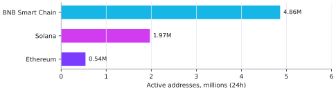
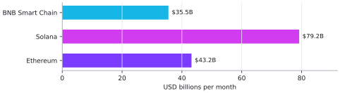

# 3 Platform Advantages

## 3.1 Design Principles

| Principle | Implementation in Oxly |
|---|---|
| **Non-Custodial** | Assets remain in the user's own wallet or are locked in an escrow smart contract. The contract owner has no authority to withdraw escrowed funds. Any order can be cancelled at any time, and escrowed funds are returned in the same transaction. |
| **Fully On-Chain** | All order, matching, and cancellation activity is recorded as on-chain transactions that anyone can verify publicly. |
| **Permissionless** | Token listing is open to anyone through automated review, and trading requires no account or KYC. Order matching is performed by operators run by Oxly, which can only settle funds to the two trading parties and the fee recipient. |
| **CEX-Grade Experience** | A real-time order book, maker/taker fee structure, limit and market orders, professional charting, and real-time WebSocket data streams. |
| **High Accessibility** | Web and mobile interfaces, wallet or QR-code authentication, and gas-free trading on BNB Smart Chain using OXG. |
| **Aligned Incentives** | A fixed maximum supply, minting only as utility requires, and buyback & burn funded by protocol revenue tie token supply dynamics directly to platform adoption. |

## 3.2 Architecture Comparison

| Parameter | Centralized Exchange (CEX) | AMM-Based DEX | Oxly |
|---|---|---|---|
| Asset Custody | Exchange operator | User | User (escrow smart contract) |
| Limit Orders | Yes | No (or via add-ons) | Yes, native |
| Order Book & Market Depth | Yes | No | Yes, fully on-chain |
| Price Discovery | Traders | Pool formula curve | Traders |
| Verifiable Settlement | No | Yes | Yes |
| Trading Without a Gas Token | Yes | No | Yes, on BSC (OXG) |
| KYC / Account Registration | Required | No | No |
| Multi-Chain Support | Yes | Separate per deployment | BSC, Ethereum, and Solana |
| Revenue Value Accrual to Token | Rarely binding | Varies | 80% of spot trading fees allocated to buyback & burn |

## 3.3 Built Where Liquidity Resides

Oxly does not ask users to migrate to a new blockchain. Instead, it brings on-chain order book infrastructure directly to the three major ecosystems where most on-chain traders already hold their assets.

<figure><figcaption>
24-hour active addresses by network, 9 November 2026 (millions) [5][8]
</figcaption></figure>

<figure><figcaption>
DEX spot volume by network, September 2026 (USD billions) [6][8]
</figcaption></figure>

Together, these three networks account for roughly three quarters of global DEX spot trading volume [7], with ±7.4 million active addresses and spot volume of ±$158 billion per month. Today, almost all of that volume is executed through AMM liquidity pools. Oxly provides order book infrastructure with limit orders and maker/taker pricing to the same user base—using the wallets and assets they already have—without bridging, new networks, or additional wallets.

This approach is a fundamental differentiator from order book protocols that run on their own app-chains or dedicated networks, where users must first bridge funds into a separate ecosystem before they can start trading.
