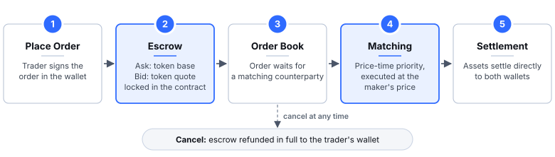

# 5 Exchange Mechanics

## 5.1 Order Lifecycle

<figure><figcaption><p></p></figcaption></figure>

```
orderId = keccak256(sender, baseToken, quoteToken, side, price, amount, nonce, expiresAt)
```

Changing any parameter produces a different ID, so an order cannot be modified once it has been placed.

| Property | Value |
|---|---|
| Order types | Limit, Market |
| Validity | 1 to 365 days (default 30 days) |
| Status | OPEN → PARTIAL → FILLED, or CANCELLED |
| Validation | Minimum amount and value per market; price and amount in tick multiples |
| Market orders | Priced at the volume-weighted average of the order book levels required |
| Rejected tokens | Fee-on-transfer tokens, because they cannot be escrowed precisely |

## 5.2 Matching and Settlement

The matching engine pairs crossing orders under price-time priority. The order recorded earlier in the order book acts as the maker, the incoming order acts as the taker, and the trade settles at the maker's price.

The operator submits matched orders to the smart contract through the `matchOrders` function. Before any assets move, the smart contract strictly validates price compatibility, quantity, and the maximum fee cap.

Operators have neither the authority nor any technical path to redirect user funds. The `matchOrders` function can only settle assets to the two trading parties and the protocol fee recipient. Any escrow remaining on a fully filled buy order is automatically refunded to the buyer.

## 5.3 Trading Fee Structure

| Category | Rate | Payment Denomination |
|---|---|---|
| Maker | 0.1% | Token asset received by the trader |
| Taker | 0.1% | Token asset received by the trader |
| Contract Maximum | 1% per side | — |

In practice, sellers pay the fee in the quote token (for example USDT), and buyers pay it in the base token. Stakers in Oxly Gas Staking are entitled to trading fee discounts of 5% to 100% on BNB Smart Chain.

## 5.4 Native Token Delivery Safeguard

If a recipient address rejects a native token transfer—for example, a smart contract wallet that does not implement a receive function—the protocol automatically converts and delivers the asset as its wrapped token (such as WBNB). This fallback ensures that a single problematic recipient can never block or fail a match or an order cancellation (anti-DoS).

## 5.5 Gas Costs for Traders

Traders pay gas only for the transactions they initiate themselves; gas for executing matches is borne entirely by the operator. On BNB Smart Chain (at a gas price of 0.05 gwei and a BNB price of $557 as of 22 November 2026 [9][10]), placing an order consumes about 138,000–212,000 gas (±$0.004–$0.006), while cancelling an order consumes about 62,000–66,000 gas (±$0.002).

With Oxly Gas (OXG), this gas cost drops to 0 BNB, except for orders that lock native BNB in escrow. Each token requires a one-time approval before its first trade; with OXG, tokens that support the `permit` standard can be approved directly through the cryptographic signature inside the order message. A full breakdown of gas per operation is provided in Appendix C.

### Cost Breakdown Simulation: Buying 100 USDT Worth of Tokens on BNB Smart Chain

| Cost Component | Gas Paid in BNB | Gas Paid with OXG |
|---|---:|---:|
| Gas for Placing the Buy Order | $0.0050 | 0 BNB |
| Gas for Match Execution | $0 | $0 |
| 0.1% Trading Fee (in the token received) | $0.10 | $0.10 |
| **Estimated Total Cost** | **≈ $0.1050** | **≈ $0.10** |
| Total with Tier 3 Staking Discount (−25% fee) | ≈ $0.0800 | ≈ $0.075 |

*Order data is packed into 6 storage slots (instead of 13), saving ±140,000 gas on every order.*

## 5.6 Authentication and Session Management

* **Wallet-Based Authentication (Wallet Login):** Users sign a single-use authentication message (cryptographic nonce) with their own wallet to obtain a session token. This removes any need for centralized account registration, passwords, or KYC.
* **Cross-Device Authentication via QR Code (Mobile-to-Web QR Login):** The web interface displays a QR code that is scanned with the Oxly mobile app. The two devices perform an ECDH P-256 key exchange to establish a shared secret, then transmit the session key encrypted with AES-GCM 256 through the Oxly session relay—a zero-knowledge relay that only forwards encrypted packets and cannot read the session key. All orders initiated through a QR session are executed via the OXG relayer, with no gas charged directly to the user.
