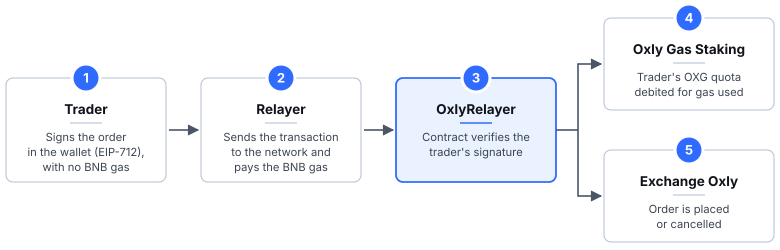

# 6 Gas-Free Trading: Oxly Gas (OXG)

## 6.1 Core Concept

Oxly Gas (OXG) is a regenerative gas quota on BNB Smart Chain. Users obtain OXG capacity by staking OXLY in the Oxly Gas Staking contract, where 1 OXG equals 1 unit of gas.

By design, OXG is not a token that can be traded or transferred between wallets; the quota is non-transferable and can only be used to execute the user's own order transactions or be delegated to another designated address.

<figure><figcaption><p></p></figcaption></figure>

## 6.2 Capacity and Regeneration Model

| Parameter | Protocol Rule |
|---|---|
| Warm-Up Period | A new stake starts generating OXG capacity after a waiting period of **14 days**. |
| Unstaking | Instant at any time, except for the portion of stake that is currently delegated. |
| Maximum Capacity | `Active Stake × capPerOxly` per 24-hour cycle, fully available as soon as the warm-up period ends. |
| Recovery | Used OXG regenerates linearly at **1/24 of total capacity per hour** and is fully restored within 24 hours. |
| Allocation Rate | `capPerOxly = min(baseRate, dailyBudget ÷ totalActiveStake)` |

The allocation rate stays constant while total active stake is below the saturation point. Once total active stake exceeds that threshold, the daily gas budget is shared proportionally, so total protocol capacity never exceeds the set daily budget. Only stake that has completed the warm-up period counts toward capacity, preventing flash-staking exploits that would dilute other users' allocations.

## 6.3 OXG Consumption per Operation

| Operation | OXG Consumed | Gas Value Equivalent (USD) | Alternative Cost in OXLY<br>(Assuming 1 OXLY = $0.01) |
|---|---:|---:|---:|
| Place Sell Order | 230,000 | $0.0064 | 0.64 OXLY |
| Place Buy Order | 240,000 | $0.0067 | 0.67 OXLY |
| Cancel Order | 115,000 | $0.0032 | 0.32 OXLY |
| Token Approval via Permit (Additional) | +20,000 | +$0.0006 | +0.06 OXLY |

*Note: Values are estimated at a network gas price of 0.05 gwei and a BNB price of $557 as of 22 November 2026 [9][10]. As long as the OXG balance is sufficient, the trader pays nothing.*

## 6.4 Handling Capacity Shortfalls (OXG Shortfall)

If a user's OXG capacity is insufficient when a transaction is submitted, the order is still executed without failure. The shortfall is automatically paid in OXLY according to the formula:

```
Shortfall Fee = OXG Shortfall × feePerGas
```

In every order message, the trader cryptographically signs a maximum fee parameter (`maxFeePerGas`), so the relayer can never charge more than the user has approved. **All OXLY paid through this shortfall mechanism is burned permanently.**

## 6.5 OXG Capacity Delegation

Stake owners can delegate their OXG capacity to external addresses—such as algorithmic trading bots, secondary wallets, or team members—for a flexible period of 1 hour to 30 days, after which the delegation expires automatically.

* **Delegation Limits:** A maximum of 10 incoming and 10 outgoing delegations per wallet address, with a minimum of 1,000 OXLY per delegation.
* **Ownership & Tier Rights:** OXLY whose capacity is delegated remains locked in the original owner's account and continues to count toward that owner's trading fee discount tier. Recipients have the full right to reject incoming delegations.

## 6.6 Funding and Budget Control

The BNB gas spent by relayers is funded entirely from the **EGF – Gas Subsidy** allocation of 20,000,000 OXLY, with a minting cap of **1,000,000 OXLY per 30-day period** locked in the token smart contract. The daily gas budget is adjusted dynamically with network activity, without exceeding that monthly cap. Protocol trading fee revenue is never used to subsidize gas.

## 6.7 OXG Scope

OXG specifically covers **order placement and cancellation on BNB Smart Chain**. Other administrative interactions—such as staking, unstaking, capacity delegation, staking reward claims, and airdrop claims—use the network's native gas token (BNB). For trading on Ethereum and Solana, each trader pays their own gas.
