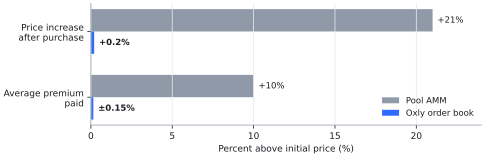
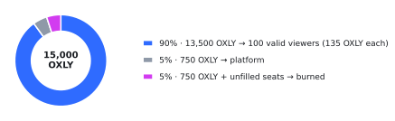

# 7 Product Ecosystem

## 7.1 Spot Trading

The Oxly spot trading interface is designed to deliver institutional exchange-terminal functionality on top of on-chain infrastructure:

* **Order Execution and Allocation Management:** Limit and market orders, with a balance slider from 0% to 100%.
* **Order Book Depth Visualization:** Real-time market depth with price-level aggregation (tick grouping), a spread indicator, the bid/ask ratio, and click-to-fill pricing that populates the order form automatically.
* **Analytical Charting:** Full TradingView integration (real-time candlesticks and technical indicators) plus a market depth chart.
* **Trade Management and Market Navigation:** Recent trades, open orders, order and trade history, portfolio summary, favorites watchlist, market pair search, and top gainers/losers.

## 7.2 USDT-Margined Perpetual Futures

Oxly offers USDT-margined perpetual futures running on decentralized derivatives infrastructure. All USDT margin is deposited directly into a vault smart contract on the user's home network—not into an exchange custody wallet. Margin balances and open positions are recorded on an on-chain ledger that anyone can audit, and every withdrawal is processed exclusively on the user's cryptographic signature. The Oxly futures system includes index and mark price calculation, an automated liquidation engine, an insurance fund, and the protocol's own futures liquidity pool.

| Specification | Protocol Rule |
|---|---|
| Contract Instrument | USDT-margined perpetual futures with no expiration |
| Leverage Limit | Up to **1000x**, adjusted dynamically by position-size risk tier and market liquidity depth |
| Margin & Position Mode | Cross and isolated margin per symbol · one-way position mode |
| Funding Rate | Every 8 hours (00:00, 08:00, and 16:00 UTC); a positive rate means longs pay shorts |
| Order Types & Execution Parameters | Limit, Market, Stop Limit, Stop Market, Take Profit / Stop Loss (TP/SL), Reduce-Only, Post-Only, and Good-Til-Canceled (GTC), Immediate-or-Cancel (IOC), and Fill-or-Kill (FOK) time-in-force |
| Fee Structure | Oxly futures maker/taker fees, published transparently in the platform interface |

### Risk Tiers and Margin Parameters (BTC Market Illustration)

| Risk Tier | Position Value Limit (USDT) | Maximum Leverage | Maintenance Margin Rate (MMR) |
|---|---:|---:|---:|
| 1 | ≤ 5,000 | 1000x | 0.05% |
| 2 | ≤ 50,000 | 500x | 0.10% |
| 3 | ≤ 250,000 | 200x | 0.25% |
| 4 | ≤ 1,000,000 | 100x | 0.50% |
| 5 | ≤ 5,000,000 | 50x | 1.00% |
| 6 | ≤ 20,000,000 | 20x | 2.50% |
| 7 | ≤ 50,000,000 | 10x | 5.00% |
| 8 | ≤ 200,000,000 | 5x | 10.00% |

### Margin, PnL, and Funding Formulas

| | Name | Formula |
|---|---|---|
| **IM** | ****Initial Margin**** | IM = (Position Value) ÷ Leverage |
| **MM** | ****Maintenance Margin**** | MM = (Position Value × MMR) − *maintenanceAmount* |
| **uPnL** | ****Unrealized PnL**** | uPnL = (Mark Price − Entry Price) × Position Size × *dir* |
| **ROE** | ****Return on Equity**** | ROE = uPnL ÷ ((Entry Price × Position Size) ÷ Leverage) |
| **FP** | ****Funding Payment**** | FP = −*dir* × Position Size × Mark Price × *fundingRate* |

*Where *dir* = +1 for long positions and *dir* = −1 for short positions.*

## 7.3 Permissionless Token Listing

| Parameter | Protocol Rule |
|---|---|
| Listing Fee | **50,000 OXLY**, paid on BNB Smart Chain through the `ListingManager` smart contract (the rate can be adjusted by the protocol owner). |
| Supported Networks | BNB Smart Chain, Ethereum, or Solana, chosen by the developer according to the token's native network. |
| Submission Authority | Open to anyone (permissionless). If the submitter is not the token contract's deployer/owner address, the project profile is marked "Unverified" until the official token team claims ownership. |
| Review | **Fully automated** (security and parameter checks), with validation results recorded permanently on-chain. |
| Market Creation | Once a submission passes validation, the trading pair is created automatically with a tick size calibrated to the token's current market price. |
| Refund Policy & Fee Allocation | The listing fee is non-refundable. 50% is burned permanently, and 50% is allocated to protocol operations. |

### Automated Token Security Screening

| Check | EVM Tokens (BNB Smart Chain & Ethereum) | Solana Tokens (SPL) |
|---|---|---|
| Standard Compliance | ERC-20 standard functions respond normally according to the specification | SPL mint configuration and metadata verified as valid |
| Honeypot Detection | Simulated buy and sell transactions execute successfully | Simulated buy and sell transactions execute successfully |
| Transaction Tax Limit | Buy tax and sell tax ≤ 10% | Transfer fee ≤ 10% |
| Transfer Integrity | No hidden deduction mechanism (fee-on-transfer) | No transfer hook that modifies or blocks transfers |
| Contract Authority Transparency | — | Mint authority and freeze authority status disclosed; the freeze authority may not freeze holder balances |

### Self-Listing Comparison

| Parameter | Centralized Exchange (CEX) | AMM-Based DEX | Oxly |
|---|---|---|---|
| Approval Authority | Internal exchange team | Anyone (permissionless) | Anyone (via automated audit) |
| Fee Structure | Negotiated, usually very high | Network gas only | 50,000 OXLY (published upfront) |
| Market Architecture | Order book | Liquidity pool | Full order book |
| Liquidity Needed for Low Price Impact | Provided by market makers | Large, requires a two-asset pair | Minimal, concentrated around the market price |
| Impermanent Loss Exposure | None | Yes | None |
| Control over Price Levels | Managed by the exchange's market makers | None (set by the formula curve) | Full control by the liquidity provider |

### Capital Efficiency of the Order Book Architecture

Structurally, an AMM spreads its liquidity across the entire possible price range (from 0 to ∞), so only a small fraction of total capital is actually active around the current market price. On the Oxly order book, by contrast, project developers and liquidity providers can place orders precisely in the price zone where trading takes place.

As an illustrative comparison, with the same total liquidity of $10,000 and a $1,000 purchase, the simulated price impact is as follows:

| Parameter | AMM Pool | Oxly Order Book |
|---|---|---|
| Liquidity Provided | $10,000 USDT + equal value of tokens (constant product) | $10,000 of sell orders, spread evenly from +0.1% to +2.0% above the price |
| Price Increase After a $1,000 Purchase | **+21%** | +0.2% |
| Average Price Paid by the Buyer | +10% above the starting price | ±0.15% above the starting price |

<figure><figcaption>
Simulated price impact of a $1,000 purchase against $10,000 of liquidity (%)
</figcaption></figure>

*Order book liquidity exists only where orders are placed, so projects or market makers need to update their orders as the price moves.*

## 7.4 Live Streaming Ecosystem: Oxly Live

| Parameter | Live Developer | Live Community |
|---|---|---|
| Host | Project developer or official token team | General users, KOLs, or influencers (subject to approval) |
| Hosting Fee | **15,000 OXLY** (paid to the Oxly treasury on BNB Smart Chain) | Free |
| Duration & Speakers | Up to 120 minutes · 1 main host + up to 2 co-hosts | Up to 120 minutes · 1 main host + up to 2 co-hosts |
| OXLY Reward Recipients | **The 100 viewers with the longest accumulated watch time** | The main host, if the target viewer threshold is reached |

### Oxly Live Distribution and Validation

<figure><figcaption>
Distribution of the 15,000 OXLY Live Developer fee
</figcaption></figure>

* **Live Developer Fund Distribution:** Of the 15,000 OXLY fee, **90% (13,500 OXLY)** is distributed equally by the platform to up to 100 valid viewers (**135 OXLY per viewer**), sent straight to their wallets with no manual claim. 5% is allocated to platform revenue, while the remaining 5% plus any unfilled viewer slots are burned permanently. The fee is refunded in full if the submission is rejected or the broadcast is cancelled before it starts.
* **Live Community Incentives:** The main host's reward is calculated as `Valid Viewers × 10 OXLY × Tier Multiplier` (×1, ×1.5, or ×2.5), funded from an ecosystem budget of 500,000 OXLY per month for two years.
* **Gift Split:** Digital gifts are paid in OXLY and split 95% to the host and 5% to the platform.
* **Valid Viewer Criteria:** A viewer is valid if they have connected an on-chain wallet and an X account, watched at least 50% of the broadcast's total duration (verified through heartbeat signals from the active browser tab), and are not a host in that session.

## 7.5 Native Mobile Client

* **Integrated Self-Custody Wallet:** Native on iOS and Android, with private keys generated and stored locally on the user's device, and support for importing existing wallets.
* **Full Multi-Chain Trading Access:** Full trading across all integrated networks, including gas-free trading on BNB Smart Chain through OXG.
* **Ecosystem Integration & Cross-Device Authentication:** Log in to the web interface by scanning a QR code, with no browser extension required, plus unified access to portfolio management, staking, airdrop claims, and Oxly Live.
