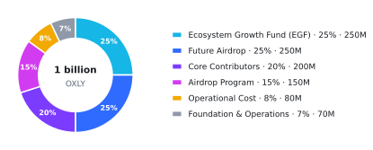
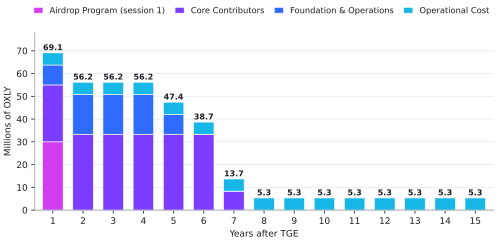

# 9 Tokenomics

## 9.1 Allocation

<figure><figcaption>
Allocation of the 1,000,000,000 OXLY maximum supply
</figcaption></figure>

| Allocation | Share | OXLY |
|---|---:|---:|
| Ecosystem Growth Fund (EGF) | 25% | 250M |
| Future Airdrop | 25% | 250M |
| Core Contributors | 20% | 200M |
| Airdrop Program | 15% | 150M |
| Operational Cost | 8% | 80M |
| Foundation & Operations | 7% | 70M |
| **Total** | **100%** | **1,000M** |

### Release & Vesting Schedule

| Allocation | Release Schedule |
|---|---|
| Ecosystem Growth Fund (EGF) | Minted as program claims are realized (per claim, see Section 9.2) |
| Future Airdrop | Not minted at TGE; reserved exclusively for future airdrop programs for users (see Section 9.4) |
| Core Contributors | 6-month cliff, followed by 24 quarterly tranches from month 6 to month 75 |
| Airdrop Program | 8 sessions with fixed quotas; Session 1 runs for 3 months from TGE, and later sessions are announced separately |
| Operational Cost | Continuous per-second linear vesting from TGE over 15 years |
| Foundation & Operations | 6-month cliff, followed by linear release over 48 months |

## 9.2 Ecosystem Growth Fund (EGF) Sub-Allocations

The Ecosystem Growth Fund (EGF) is partitioned directly in the token smart contract into three separate sub-allocations, each with its own quota cap and independent minter authority. This on-chain separation guarantees that the budget for one ecosystem program can never be merged with, or redirected to fund, another.

| Sub-allocation | OXLY | Purpose | Limit |
|---|---:|---|---|
| Staking Reward | 200M | Oxly Staking rewards | Max. 40M per year |
| Gas Subsidy | 20M | OXG relay gas on BNB Smart Chain | Max. 1M per 30 days |
| LP & New Products | 30M | Live Community (≤ 12M over two years), liquidity incentives (≥ 18M) | Live: 500k per month |
| **Total** | **250M** |   |   |

## 9.3 Minting Governance

At initial deployment, OXLY's circulating supply is zero. The token smart contract stores a maximum quota and a cumulative minted counter for each allocation separately; any mint request automatically reverts if `minted + amount > quota`.

* **Registered Minter Authorization:** Only officially registered minter addresses may mint from their respective allocations.
* **Permanent Lock on Scheduled Allocations:** Minter addresses for all scheduled (vesting) allocations are permanently locked (immutable) and cannot be changed by anyone.
* **Multisig Control of Dynamic Pools:** Minter authority for the Ecosystem Growth Fund (EGF) sub-allocations and the Future Airdrop pool is managed through the protocol owner's multisig wallet, while remaining strictly bound by each pool's maximum quota.
* **Permanent Deflation:** Every OXLY that has been burned is permanently removed from circulation and never returns to any minting quota.

## 9.4 Future Airdrop Allocation Rules

The 250,000,000 OXLY Future Airdrop allocation is an integral part of the 65% community share and is governed by strict constraints:

* **Exclusively for the Community:** Funds in this pool may only be used for airdrop distribution programs to protocol users.
* **Program-Based Minter Activation:** Minter authority is assigned temporarily by the owner multisig only while an airdrop program is active.
* **Public Pre-Release Disclosure:** Every planned release or distribution must be publicly announced before the execution transaction is carried out.
* **On-Chain Hard Cap:** Total minting is capped at 250,000,000 OXLY by the smart contract, and the quota does not have to be minted in full if it is not allocated to community distribution programs.

## 9.5 Vesting Schedule

| Allocation | Recipient | Cliff | Schedule | Completion |
|---|---|---|---|---|
| Core Contributors | Team multisig | 6 months | 24 tranches of ±8.33M every 3 months (months 6–75) | Month 75 (Feb 2033) |
| Foundation & Operations | Foundation multisig | 6 months | Per-second linear over 48 months (±1.46M/month) | Month 54 (May 2031) |
| Operational Cost | Operations wallet | — | Per-second linear over 180 months (±444k/month) | Year 15 (Nov 2041) |
| Airdrop Program | Eligible users | — | 8 sessions; session 1 from TGE, sessions 2–8 when announced | When the 8th session ends |

## 9.6 Scheduled Annual Emission

<figure><figcaption>
Maximum emission of scheduled allocations (millions of OXLY). Airdrop sessions 2–8 (120M in total) are unscheduled; each adds at most its quota when announced and run.
</figcaption></figure>

| Claim-based flows (additional) | Upper limit |
|---|---|
| Staking rewards | ≤ 40M per year, and only if total stake > 166.7M |
| Gas Subsidy | ≤ ±12.2M per year |
| LP & New Products | 30M in total; Live Community ≤ 6M per year for two years |

Unclaimed airdrop rewards and unused staking emission quotas are **never minted**. Actual net emission is therefore always equal to or below the maximum projection above, and is reduced further by token burns.

## 9.7 Circulating Supply Schedule

| Timeline | Event and Circulating Supply Projection |
|---|---|
| **TGE (25 November 2026)** | ≈ 0 OXLY circulating; linear Operational Cost release begins at ±14,800 OXLY per day. |
| **Month 3 (February 2027)** | Airdrop Session 1 distribution ends (±30,000,000 OXLY); estimated circulating supply reaches ±32,000,000 OXLY. |
| **Month 6 (May 2027)** | First quarterly Core Contributors tranche; linear Foundation & Operations release begins. |
| **Month 54 (May 2031)** | Foundation & Operations vesting completes (70,000,000 OXLY). |
| **Month 75 (February 2033)** | Core Contributors vesting completes (200,000,000 OXLY). |
| **Year 15 (November 2041)** | Linear Operational Cost release completes (80,000,000 OXLY). |

## 9.8 Fair Launch and Price Discovery

OXLY launches with no presale round, no pre-minted liquidity allocation, and no initial price set or supported by the internal team. The first OXLY to enter circulation comes solely from airdrop claims by active users and the linear Operational Cost release, and valuation and price discovery are determined entirely and organically by supply and demand on the Oxly order book.
