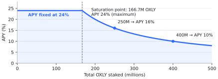

# 10 Staking

Oxly offers two staking products that operate separately on BNB Smart Chain. Each OXLY can be staked in only one of the contracts at a time, but users have full flexibility to split their holdings between both products in any proportion.

### Oxly Staking Product Comparison

| Specification | Oxly Staking | Oxly Gas Staking |
|---|---|---|
| Core Utility & Benefit | APY-based OXLY rewards | OXG gas capacity and access to trading fee discount tiers |
| Lock-Up Period | None; staking, unstaking, and reward claims can be done at any time | No withdrawal lock-up; a 14-day warm-up period applies before the OXG quota and fee discounts become active |
| Reward Emission Source | Minted on claim (on-demand mint) from the EGF – Staking Reward allocation | — (generates no token emission) |
| Trading Fee Discount | Not included | Yes (according to the active stake tier) |

## 10.1 Oxly Staking (APY)

| | Name | Formula |
|---|---|---|
| **APY** | ****Annual Percentage Yield**** | APY = min( 24% , (40,000,000 OXLY per year) ÷ (Total OXLY staked) ) |

<figure><figcaption>
Oxly Staking APY versus total OXLY staked
</figcaption></figure>

* Rewards accrue **every second** and can be claimed or compounded at any time.
* APY holds at **24%** until total stake reaches 166.7M OXLY; above that level, the annual emission is shared among all stakers.
* Rewards are minted on claim from the 200M allocation; at full emission this lasts about 5 years, and longer because unused emission is never minted.
* The maximum APY and annual emission can be adjusted by the owner.

## 10.2 Oxly Gas Staking

The Oxly Gas Staking contract serves two core functions in the Oxly utility ecosystem: it accumulates OXG capacity to enable gas-free trade execution (as described in Section 6), and it determines the spot trading fee discount tier on BNB Smart Chain.

| Tier | Minimum Active Stake | Equivalent Value (Assuming 1 OXLY = $0.01) | Trading Fee Discount |
|---|---:|---:|---:|
| 1 | 10,000 OXLY | $100 | 5% |
| 2 | 50,000 OXLY | $500 | 10% |
| 3 | 250,000 OXLY | $2,500 | 25% |
| 4 | 1,000,000 OXLY | $10,000 | 50% |
| 5 | 10,000,000 OXLY | $100,000 | 100% (zero fee) |

Tier thresholds are denominated in OXLY and can be adjusted by the protocol owner, up to a maximum of 5 tiers. Qualification counts only active stake that has completed the warm-up period, while stake whose OXG capacity is delegated to others still counts toward the original owner. Tier 5 is designed specifically for institutional liquidity providers (market makers), granting a full trading fee waiver in return for staking 1% of OXLY's maximum supply.
