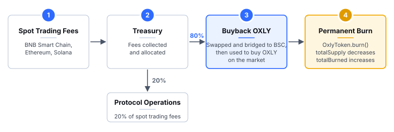

# 11 Revenue, Buyback & Burn

## 11.1 Protocol Revenue Streams

| Revenue Source | Rate Structure | Distribution & Allocation |
|---|---|---|
| **Spot Trading Fees (BSC, Ethereum, Solana)** | Maker 0.1% / Taker 0.1% | **80% to buyback & burn** · 20% to protocol operations |
| **Token Listing Fees** | 50,000 OXLY per listing submission | **50% burned permanently** · 50% to protocol operations |
| **OXG Shortfall Fees** | Paid in OXLY when the OXG quota is insufficient | **100% burned permanently** |
| **Oxly Live – Live Developer** | 15,000 OXLY per broadcast session | 90% distributed to valid viewers · 5% platform revenue · **5% + unfilled seats burned** |
| **Oxly Live – Gifts** | Set per gift transaction | 95% to the host · 5% platform revenue |
| **Futures Trading** | According to the futures fee schedule | 100% allocated to protocol operations |

## 11.2 How Buyback & Burn Works

<figure><figcaption><p></p></figcaption></figure>

### Burn Execution and Transparency

* **Single-Path Burn Execution:** Product smart contracts do not burn automatically within individual transactions; all OXLY-denominated fee receipts are first collected in the protocol treasury and then allocated and burned centrally through a call to the `burn()` function.
* **Periodic Batch Execution and Public Reporting:** Buybacks and burns run on a regular batch schedule, and every execution is published openly on the platform with the amount and the on-chain transaction hash.

## 11.3 Burn Cap Policy

To preserve market liquidity depth and the long-term sustainability of ecosystem utility, the platform applies a policy that caps cumulative token burns at **75% of total minted supply (`totalMinted`)**. This policy ensures that at least 25% of all OXLY ever issued always remains in circulation, and it is verified by platform operations each time `burn()` is executed.

```
Circulating Supply = totalMinted − totalBurned = totalSupply()
```
