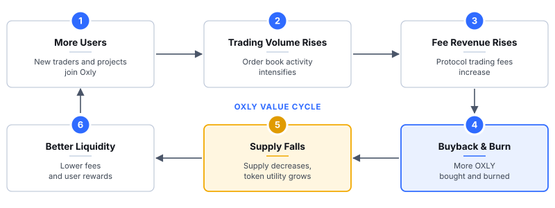
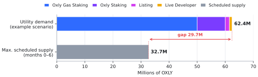
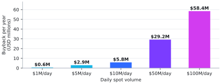
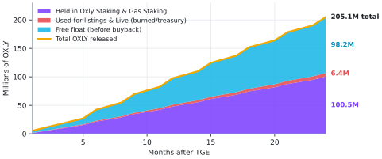
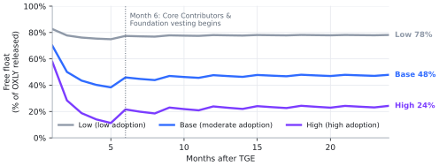
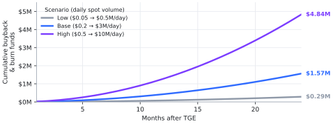

# 12 Value Accrual & Token Growth Potential


**Illustrative only.** This section explains the mechanisms that link platform activity to OXLY demand and supply using a simple model and hypothetical inputs. These figures are not predictions, price targets, or promises. The OXLY price is set by buyers and sellers and can go down as well as up.


## 12.1 The Value Cycle

<figure><figcaption>

</figcaption></figure>

OXLY accrues value through two fundamental mechanisms working simultaneously: organic **demand** growth in line with platform adoption and trading volume, and controlled **supply** that is issued only as distribution is realized (on-demand mint) and is permanently reduced through burns.

## 12.2 Demand Drivers

| Demand Driver | Mechanism | Demand Characteristics |
|---|---|---|
| **Buyback Program** | 80% of spot trading fees across all three networks is allocated to buying OXLY directly on the open market. | Recurring; grows with trading volume. |
| **Token Listing** | Every project submission must pay a fee of 50,000 OXLY. | Recurring; rises as more new projects join. |
| **Oxly Live (Live Developer)** | Project developers must commit 15,000 OXLY per broadcast session. | Recurring; in line with the frequency of project promotion. |
| **Trading Fee Discounts** | Staking up to 10,000,000 OXLY for spot fee discounts of up to 100%. | Held/staked; rises with the scale of trader and market maker activity. |
| **Gas-Free Trading** | Active traders stake OXLY to obtain OXG capacity. | Held/staked; grows with order placement frequency. |
| **Staking Rewards** | Staking with yields of up to 24% APY and no lock-up. | Held/staked; voluntarily reduces circulating liquidity. |
| **Gas Shortfall Compensation** | OXG shortfalls are paid in OXLY, which is then burned permanently. | Recurring; directly reduces circulating supply. |

## 12.3 Limited Circulating Supply, Multiple Utilities

### Origin of the Initial Circulating Supply

No entity or insider starts the launch phase with a large allocation. Throughout the first six months after TGE, almost all new OXLY enters circulation exclusively through the community airdrop program—and is minted only when eligible participants actively earn and claim their allocations.

| Scheduled source, months 0–6 | Max. OXLY | Share |
|---|---:|---:|
| Airdrop (session 1), earned by the community | 30,000,000 | 91.8% |
| Operational Cost | 2,670,000 | 8.2% |
| Core Contributors | 0 | 0% |
| Foundation & Operations | 0 | 0% |
| **Total** | **32,670,000** | **100%** |

### Utility Demand vs. Scheduled Supply Simulation (First 6 Months)

| Utility Category / Parameter | Adoption Scenario Assumption | Token Requirement |
|---|---|---:|
| Oxly Gas Staking | 1,000 Tier 1 traders, 200 Tier 2, 40 Tier 3, 10 Tier 4, and 1 Tier 5 market maker | 50,000,000 OXLY |
| Oxly Staking | Community participation in yield staking | 10,000,000 OXLY |
| Token Listing Fees | 5 listing submissions per month for 6 months (30 × 50,000 OXLY) | 1,500,000 OXLY |
| Oxly Live – Live Developer | 10 broadcast sessions per month for 6 months (60 × 15,000 OXLY) | 900,000 OXLY |
| **Total Platform Utility Demand** | **Cumulative pure utility demand over the first 6 months** | **62,400,000 OXLY** |
| **Maximum Scheduled Supply** | Maximum emission over the same 6-month period | **32,670,000 OXLY** |

<figure><figcaption>
Platform utility demand versus maximum scheduled supply, months 0–6 (millions of OXLY, example scenario)
</figcaption></figure>

In this moderate adoption scenario, the platform's own organic utility demand already exceeds the maximum supply that can circulate during the first six months by **29,730,000 OXLY**—before accounting for buy pressure from the protocol buyback or accumulation by investors who hold. Because all minting quotas are permanently locked in the token smart contract, the protocol cannot add supply in response to such a demand surge, so the balancing mechanism rests entirely on price adjustment in the open market (price discovery).

## 12.4 Buyback Model

| | Name | Formula |
|---|---|---|
| **BB** | ****Annual Buyback (USD)**** | BB = Daily Spot Volume × 365 × 0.2% × 80% = Daily Spot Volume × 0.584 |

*Where: 365 = days per year · 0.2% = 0.1% maker fee + 0.1% taker fee per trade · 80% = share of fees allocated to buyback & burn.*

<figure><figcaption>
Annual buyback & burn by daily spot volume (USD millions, gross)
</figcaption></figure>

| Share of current 3-chain DEX spot volume | Daily volume | Annual buyback |
|---|---:|---:|
| 0.1% | ~$5.3M | ~$3.1M |
| 0.5% | ~$26.3M | ~$15.4M |
| 1.0% | ~$52.6M | ~$30.7M |
| 2.0% | ~$105.2M | ~$61.4M |

*DEX spot volume across the three chains was ±$158 billion in September 2026 (±$5.3 billion per day, Section 3.3). Staker fee discounts reduce the buyback proportionally.*

## 12.5 Buyback Yield (Buyback to Market Cap Ratio)

| | Name | Formula |
|---|---|---|
| **BY** | ****Buyback Yield**** *Buyback to Market Cap Ratio* | Buyback Yield = (Annual Buyback Value) ÷ (Circulating Market Cap) |

The analysis in this section uses a conservative assumption of 150,000,000 OXLY in circulation—more than twice the projected scheduled supply at the end of Year 1 (69,000,000 OXLY).

| Price | Market cap (150M) | Yield @ $1M/day | @ $10M/day | @ $50M/day |
|---:|---:|---:|---:|---:|
| $0.01 | $1.5M | 38.9% | 389% | 1,947% |
| $0.05 | $7.5M | 7.8% | 77.9% | 389% |
| $0.10 | $15.0M | 3.9% | 38.9% | 195% |
| $0.25 | $37.5M | 1.6% | 15.6% | 77.9% |
| $0.50 | $75.0M | 0.8% | 7.8% | 38.9% |

A buyback yield above 100% means that within one year, the protocol's buyback funds would have to absorb more OXLY than the entire circulating supply at that price—a condition that is mathematically impossible without market price appreciation. The buyback mechanism therefore creates **upward price pressure that builds progressively as trading volume grows**, until the yield reaches equilibrium with sell-side liquidity in the market.

## 12.6 Emission Break-Even Threshold

| | Name | Formula |
|---|---|---|
| **BEV** | ****Break-Even Daily Volume**** | BEV = (Annual Scheduled Emission × OXLY Price) ÷ 0.584 |

| Price | Year 1 (69.1M) | Years 2–4 (56.2M/year) | Per additional airdrop session (25M) |
|---:|---:|---:|---:|
| $0.005 | $0.59M/day | $0.48M/day | + $0.21M/day |
| $0.01 | $1.18M/day | $0.96M/day | + $0.43M/day |
| $0.05 | $5.91M/day | $4.81M/day | + $2.14M/day |
| $0.10 | $11.83M/day | $9.62M/day | + $4.28M/day |

Above the break-even volume, the buying generated by the protocol buyback exceeds the value of all scheduled emissions entering circulation—even in the extreme scenario where 100% of newly released tokens are sold immediately. From Year 7 onward, scheduled emission falls below 14,000,000 OXLY per year, so the same trading volume delivers a far stronger net deflationary effect and valuation support.

## 12.7 Price-Inelastic Product Demand

| Product activity (example) | OXLY bought from the market / year | OXLY burned / year |
|---|---:|---:|
| 10 listings per month | 6,000,000 | 3,000,000 |
| 25 listings per month | 15,000,000 | 7,500,000 |
| 20 Live Developer broadcasts per month | 3,600,000 | ≥ 180,000 |
| 10 market makers in Tier 5 | 100,000,000 staked | — |

This demand operates outside the fee-based buyback and is independent of OXLY market price fluctuations. Because the token listing fee (50,000 OXLY) and the Live Developer fee (15,000 OXLY) are fixed in OXLY units, every project and host must absorb a constant number of tokens from the open market regardless of the token's price at the time.

## 12.8 24-Month Token Flow Simulation

Oxly models net token flow over the first 24 months under three adoption scenarios, comparing every source of new supply—the airdrop program (conservatively assuming a new session every six months), vesting of locked allocations, staking rewards, and Ecosystem Growth Fund (EGF) programs—against the OXLY locked in staking contracts and absorbed by listings and Oxly Live. The model is built in real token units, so its results are objective and do not depend on any price assumptions.

| Assumptions at month 24 | Low | Base | High |
|---|---:|---:|---:|
| Daily spot volume | $0.5M | $3M | $10M |
| Gas Staking users (Tier 1/2/3/4/5) | 300/50/10/2/0 | 1,000/200/40/10/1 | 2,000/400/60/15/2 |
| Share of circulating OXLY in Oxly Staking | 15% | 25% | 30% |
| Listings / Live Developer per month | 2 / 3 | 5 / 10 | 15 / 25 |

<figure><figcaption>
Where released OXLY flows, Base scenario, before buyback & burn (millions of OXLY). The three layers add up to total OXLY released.
</figcaption></figure>

<figure><figcaption>
Share of released OXLY that is freely tradable (free float), before buyback & burn. The lower it is, the more OXLY is held in staking and utility.
</figcaption></figure>

<figure><figcaption>
Cumulative USD from the 80% of spot trading fees allocated to buyback & burn, after staker fee discounts.
</figcaption></figure>

| Scenario | Month | OXLY released | Held in staking | Free float | Cumulative buyback USD |
|---|---:|---:|---:|---:|---:|
| Low | 12 | 85.6M | 17.5M | 78% | $0.08M |
| Low | 24 | 179.7M | 36.8M | 78% | $0.29M |
| Base | 12 | 97.6M | 48.0M | 48% | $0.43M |
| Base | 24 | 205.1M | 100.5M | 48% | $1.57M |
| High | 12 | 111.1M | 75.1M | 24% | $1.28M |
| High | 24 | 232.6M | 157.2M | 24% | $4.84M |

### Key Implications of the Simulation

The model shows the direct effect of utility lock-up on secondary market liquidity: in the Base scenario, about 50% of all released OXLY is absorbed and locked in staking contracts, leaving only around half freely circulating in the market—even before supply reduction from buybacks. In the High scenario, the free float shrinks further to about 24% of total release. A structurally thinner free float increases market sensitivity, so every capital inflow or outflow produces larger price moves in either direction.
