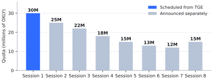
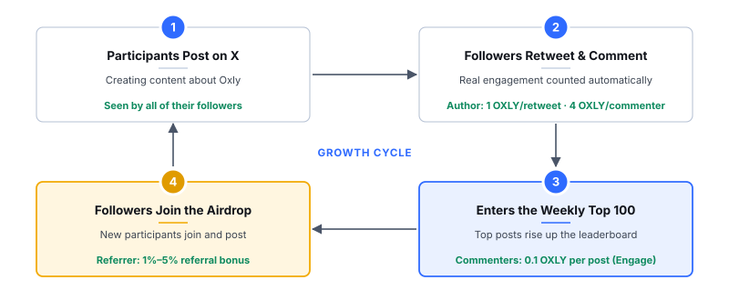
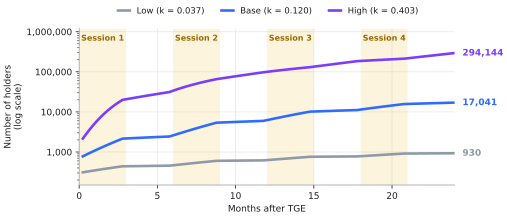
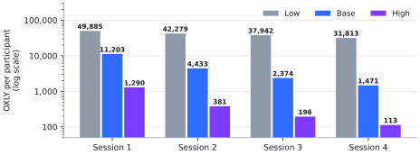

# 13 Airdrop Program (Fairlaunch)

## 13.1 Overview

**150,000,000 OXLY** (15% of supply) is distributed to the community across **8 sessions**, each with a fixed quota enforced by the `OxlyAirdrop` contract. Quotas decline over time to reward early participation, with a larger final session for loyal users.

<figure><figcaption>
Airdrop quota per session, 150 million OXLY in total
</figcaption></figure>

| Session | Period (UTC) | Quota | Share |
|---|---|---:|---:|
| 1 | 25 Nov 2026 – 24 Feb 2027 (claims until 25 May 2027) | 30M | 20.0% |
| 2 | Announced separately | 25M | 16.7% |
| 3 | Announced separately | 22M | 14.7% |
| 4 | Announced separately | 18M | 12.0% |
| 5 | Announced separately | 15M | 10.0% |
| 6 | Announced separately | 13M | 8.7% |
| 7 | Announced separately | 12M | 8.0% |
| 8 | Announced separately | 15M | 10.0% |
| **Total** |   | **150M** | **100%** |

### Session Execution Mechanics

* **Session 1 Launch:** Session 1 starts at TGE, runs for 3 months, and uses the distribution components described in this section.
* **Independent Sessions and Closure:** Each session is a separate, self-contained distribution program. When a session's period ends or its quota is reached, the session is formally closed and airdrop distribution pauses; any remaining rewards from a closed session are not carried over to the next.
* **Activation of Later Sessions (Sessions 2–8):** Sessions 2 through 8 do not start automatically or immediately after the previous session; each begins only after an official announcement. Every announcement sets the period, rules, and task criteria, which may be tailored—for example, to existing users with spot or futures trading activity parameters. Session dates are recorded in the OxlyAirdrop contract by the protocol owner before the session starts and may be adjusted only before the session ends; sessions never overlap, and a gap between sessions is allowed.
* **Program Completion:** The airdrop program as a whole is not tied to a fixed end date; it is complete once all eight sessions have run.

## 13.2 Eligibility Requirements

To participate in the airdrop distribution program and qualify to claim rewards, users must complete the following verification steps:

1. ****Account Authorization and Wallet Binding**.** Register through X OAuth authentication, which binds one X account exclusively to one wallet address.
2. ****Social Task Verification**.** Follow Oxly's official X account, connect a Telegram account, and join Oxly's official Telegram community group and announcement channel.
3. ****On-Chain Activity Validation**.** Execute at least one transaction on the Oxly platform.

## 13.3 Components (Session 1)

* **1 · Social Campaign** — Post about Oxly on X. Engagement is counted on days 10, 20, and 30 after approval: **1 OXLY per retweet** and **4 OXLY per unique commenter**.
* **2 · Engage** — Comment on **this week's top 100 posts**: **0.1 OXLY per post** that remains in the final top 100 when the week closes.
* **3 · Tiered Referral** — L1 5 referrals → 1% · L2 20 → 2% · L3 50 → 3% · L4 100 → 5% of referral earnings.
* **4 · Trading Volume** — Spot volume on BNB Smart Chain per session: 0–1k USDT → 1,000 · 1k–10k → 4,000 · >10k → 12,000 OXLY. OXLY pairs count 2×.

| | Name | Formula |
|---|---|---|
| **RC** | ****Social Campaign Reward**** *per count (days 10, 20, 30)* | RC = ΔRetweets × 1 OXLY + ΔUnique Commenters × 4 OXLY |
| **RE** | ****Referral Bonus Entitlement**** *Σ over all valid referrals* | RE = Level % × Σ (Campaign Reward + Volume Reward) |
| **NB** | ****New Referral Bonus**** | NB = max(0, RE − Bonus Already Received) |

### Validation Criteria and Exclusions (Anti-Sybil & Wash-Trading Filters)

* **Social Interaction Exclusions:** Likes, quote tweets, interactions from the author's own account, and interactions from accounts registered for 1 year or less are not counted. In addition, contributions from a single commenter account are capped at 3 per 24-hour period.
* **Trading Volume Exclusions:** Self-trading, trades between wallets identified as related, and zero-fee volume are excluded from qualifying volume.
* **Per-Session Parameter Adjustment:** All of the above are baseline parameters that may be adjusted for each airdrop session and will be officially announced before the session takes effect.

## 13.4 Claim Mechanics

| Rule | Technical Specification |
|---|---|
| Accumulation Model | **Cumulative Claim Model:** The Oxly system issues an EIP-712 cryptographic signature authorizing a wallet address's total cumulative entitlement; the user claims the difference between that total and the amount already claimed (`Claim = Total Entitlement − Already Claimed`). |
| Scope & Timing | All reward components are combined into a single claim transaction that can be executed at any time after the first reward credit is recorded. |
| Gas Fee | Paid entirely by the user in BNB when executing the claim transaction on BNB Smart Chain. |
| Claim Deadline | **90 days after the session ends**; any reward not claimed by the deadline is **never minted**. |
| Closure & Quota Cap | Once a session's quota is reached, the session closes automatically; rewards earned beyond the session quota are not paid and are not carried over to the next session. |

## 13.5 Anti-Sybil Safeguards

To protect distribution integrity and ensure rewards reach only valid, organic participants, Oxly applies layered verification filters:

* **Identity & Account Age Verification:** One X account bound exclusively to one wallet address through OAuth, with X accounts required to be more than 1 year old.
* **Real Activity Validation:** At least one valid transaction on the Oxly platform is required.
* **Social Interaction Moderation:** Quality review of published comments and a frequency cap of 3 comments per 24 hours per account.
* **Volume Manipulation Filtering:** Automatic exclusion of self-trading, activity between wallets identified as related, and zero-fee volume.

## 13.6 Community-Driven Growth Engine

The Fairlaunch program is strategically designed as Oxly's primary marketing and user acquisition engine. Rather than spending a budget on conventional one-way advertising, Oxly distributes value directly to the community in OXLY, rewarding the network reach and organic growth the community creates itself.

<figure><figcaption>

</figcaption></figure>

### Community Growth Flywheel

| Growth Mechanism | Strategic Impact on the Ecosystem |
|---|---|
| **Social Campaign** | Turns every participant into an organic content creator. Because rewards depend on real engagement, participants are motivated to produce high-quality posts that people want to share. |
| **Weekly Top 100** | A public leaderboard updated every Monday that focuses community attention and visibility on the best-performing posts. |
| **Engage Mechanism** | Concentrates conversation about Oxly in a given week and set of post threads—a concentrated interaction pattern that naturally triggers trending-topic algorithms. |
| **Tiered Referral System** | Provides a sustained, long-term incentive for participants to invite and educate new users into the ecosystem. |
| **Trading Volume Incentive** | Converts new users arriving through the community into active traders who contribute directly to market liquidity and protocol buyback funding. |

### Viral Growth Modeling

To project the effectiveness of organic user acquisition from the Fairlaunch program, Oxly uses an epidemiological modeling framework based on a weekly viral coefficient (*k*), calibrated with audience saturation and the economic incentives of participants:

| | Name | Formula |
|---|---|---|
| **k** | ****Viral Coefficient**** *per week* | *k* = *P*post × *F*post × *N̄*follower × *R*impr × *B*engage × *R*conv |
| **ΔU** | ****New Participants**** *per week* | Δ*U*new = *U*active × *k* × *M* × (1 − *U*reached ÷ *U*audience) |
| **M** | ****Motivation Index**** | *M* = *R* ÷ (*R* + $25) , *R* = *Q*session ÷ *U*active × $0.01 |
| **Ut+1** | ****Next-Period Active Participants**** *U* | *U*active, t+1 = *U*active, t × (1 − *r*churn) + Δ*U*new |
| **N** | ****Number of Holders**** | *N*holder = *U*cumulative × *R*retention |

***Variable Definitions:***

* *k*: Weekly viral coefficient (new participants generated per active participant per week).
* *P*post, *F*post: Share of active participants who publish content, and posting frequency per week.
* *N̄*follower, *R*impr: Average followers per account and organic impression rate.
* *B*engage, *R*conv: Engage multiplier and the conversion rate of audience into verified participants.
* *M*, *R*: Participation motivation index and projected reward value per active participant (at a reference valuation of $0.01 per OXLY).
* *U*reached, *U*audience: Total population already exposed to the campaign versus the total addressable audience on X.

### Viral Growth Scenario Assumptions

| Model Parameter | Low Scenario | Base Scenario | High Scenario |
|---|---:|---:|---:|
| Initial Participants (*U*0) | 500 | 1,000 | 2,000 |
| Share Posting · Frequency / Week | 30% · 1.5 | 40% · 2.0 | 50% · 2.0 |
| Average Followers · Impression Rate | 300 · 5% | 500 · 6% | 600 · 8% |
| Engage Multiplier (*B*engage) · Conversion Rate | ×1.10 · 0.5% | ×1.25 · 0.4% | ×1.40 · 0.6% |
| Weekly Churn · Total X Audience | 2.0% · 3,000,000 | 2.0% · 5,000,000 | 1.5% · 10,000,000 |
| Conversion to OXLY Holders | 60% | 70% | 80% |
| **Viral Coefficient (*k*) at Full Motivation** | **0.037** | **0.120** | **0.403** |

<figure><figcaption>
Cumulative holders from the campaign by scenario (logarithmic scale). Shaded areas mark active airdrop sessions, assuming a new session every six months.
</figcaption></figure>

<figure><figcaption>
Average OXLY received per participant in each session (logarithmic scale). The more participants there are, the more people share the same session quota.
</figcaption></figure>

| Scenario | Month 3 | Month 6 | Month 12 | Month 24 | OXLY per participant, session 1 → 4 |
|---|---:|---:|---:|---:|---:|
| Low | 441 | 465 | 627 | 930 | 49,885 → 31,813 |
| Base | 2,175 | 2,594 | 6,230 | 17,041 | 11,203 → 1,471 |
| High | 20,698 | 33,733 | 99,806 | 294,144 | 1,290 → 113 |

### Sensitivity to the Viral Coefficient (*k*) and Supply Discipline

The most decisive variable in this model is the viral coefficient (*k*), which measures the average number of new participants each active participant brings in per week. *k* rises with the share of participants actively posting, posting frequency, and the appeal of the content—exactly the factors the campaign's incentive scheme rewards.

* **Scenario Comparison:** In the Low scenario, *k* is roughly in balance with participant churn. In the Base scenario, 1,000 initial participants grow to about 17,000 holders within two years. In the High scenario, adoption accelerates to hundreds of thousands of holders.
* **Growth Independent of Token Emission:** A larger participant base never increases token supply. Because each session's reward quota is locked by the smart contract, more participants simply share the same quota across a broader base of recipients. Viral growth therefore increases only the number of holders, never the number of tokens issued.

## 13.7 Distribution Designed to Mitigate Selling Pressure

| Distribution Design Feature | How It Mitigates Concentrated Selling |
|---|---|
| **Earned, Not Given** | Every OXLY is earned through real participation and contribution, so participants value their holdings more and are less likely to sell impulsively at any price. |
| **Phased Release** | Rewards accrue in stages (day 10/20/30 counts, weekly Engage, per-session volume), preventing large amounts of supply from entering the market all at once. |
| **Flexible Claim Timing** | Participants can claim at any time within the 90-day window, so claims and profit-taking spread out naturally over time. |
| **Decentralized Distribution** | Tokens are spread across a broad retail holder base rather than concentrated in a handful of large (whale) wallets. |
| **Holding Incentives** | Holders have strong reasons to keep their tokens: up to 24% APY staking, trading fee discounts, OXG gas quota, and Oxly Live. |
| **Declining Quota Schedule** | The distribution quota decreases progressively from 30,000,000 OXLY to 12,000,000 OXLY over the first seven sessions. |
| **Ongoing Buyback Support** | 80% of spot trading fee revenue is consistently allocated to buying back OXLY on the open market. |
