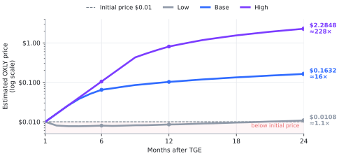
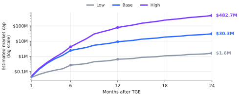

# G Appendix: OXLY Price Model Estimates


**Estimates, not guarantees.** This appendix estimates how adoption, trading volume, staking, and new buyer inflows could affect the OXLY price, starting from an initial price of $0.01. All figures are **estimates** that depend entirely on the assumptions below. The actual price is set by the market and may be far lower or higher, including below the initial price. These estimates are not predictions, targets, promises of return, or a solicitation to buy. Read Section 17 (Risk Factors & Legal Disclaimer).


## G-1. Estimation Formula

| | Name | Formula |
|---|---|---|
| **P** | ****Next-Month Price**** *ε = 0.5 · change −40%…+60%/month* | Pt+1 = Pt × [1 + ε × (Demand − Sales) ÷ (Free Float)] |
| **D** | ****Demand (OXLY)**** *bought from the market* | Buyback + New Buyers + Listings + Live Developer + New Stake |
| **S** | ****Sales (OXLY)**** *supply sold to the market* | Airdrop × % Sold + Operational + Gas Subsidy + 30% Contributors + 50% Foundation + 30% Staking Rewards + 50% Live Community |

*Initial price $0.01. All demand and sales components are calculated in OXLY per month.*

## G-2. New Buyers and Market Cap

A buyer who spends **I dollars** buys I ÷ P OXLY. From the formula above:

| | Name | Formula |
|---|---|---|
| **ΔP** | ****Price Increase**** *Price Impact* | ΔP ÷ P = ε × I ÷ (P × Free Float) |
| **ΔMC** | ****Market Cap Increase**** *Market Cap Impact* | ΔMcap = ε × I × Circulating ÷ (Free Float) |

| Condition | Circulating ÷ Free Float | Estimated market cap added per $1 of buying |
|---|---:|---:|
| 80% freely circulating | 1.25 | $0.63 |
| 50% freely circulating | 2.0 | $1.00 |
| 25% freely circulating | 4.0 | $2.00 |
| 10% freely circulating | 10.0 | $5.00 |

The more OXLY is held in staking, Gas Staking, listings, and Live, the smaller the free float and the larger the impact of each dollar of buying. The reverse also holds: each dollar of selling reduces market cap by the same multiplier.

## G-3. Scenario Assumptions (Values at Month 24)

| Assumption | Low | Base | High |
|---|---:|---:|---:|
| Daily spot volume | $50k → $500k | $200k → $3M | $500k → $10M |
| New buyers per month · average purchase | 50 → 500 · $100 | 200 → 3,000 · $200 | 500 → 10,000 · $300 |
| Gas Staking (Tier 1/2/3/4/5) | 300/50/10/2/0 | 1,000/200/40/10/1 | 2,000/400/60/15/2 |
| Share of circulating supply in Oxly Staking | 15% | 25% | 30% |
| Listings · Live Developer per month | 2 · 3 | 5 · 10 | 15 · 25 |
| Airdrop claimed · sold immediately | 70% · 60% | 80% · 45% | 90% · 30% |
| Average fee discount | 10% | 15% | 20% |

## G-4. Estimated Results

<figure><figcaption>
Estimated OXLY price by scenario, starting from the $0.01 initial price (logarithmic scale).
</figcaption></figure>

<figure><figcaption>
Estimated circulating market cap by scenario (logarithmic scale).
</figcaption></figure>

| Scenario | Month | Est. price | Circulating | Free float | Daily volume | Est. market cap | Mcap per $1 |
|---|---:|---:|---:|---:|---:|---:|---:|
| Low | 6 | $0.0080 | 32.8M | 25.3M | $0.15M | $0.3M | $0.65 |
| Low | 12 | $0.0085 | 74.9M | 58.0M | $0.27M | $0.6M | $0.65 |
| Low | 24 | $0.0108 | 146.7M | 113.1M | $0.50M | $1.6M | $0.65 |
| Base | 6 | $0.0647 | 37.4M | 16.2M | $0.81M | $2.4M | $1.15 |
| Base | 12 | $0.1027 | 88.4M | 40.5M | $1.54M | $9.1M | $1.09 |
| Base | 24 | $0.1632 | 185.4M | 85.4M | $3.00M | $30.3M | $1.08 |
| High | 6 | $0.1049 | 40.1M | 5.3M | $2.57M | $4.2M | $3.80 |
| High | 12 | $0.8084 | 97.3M | 19.9M | $5.04M | $78.7M | $2.44 |
| High | 24 | $2.2848 | 211.3M | 47.8M | $10.00M | $482.7M | $2.21 |

* **Low:** the price dips to ±$0.0077 as airdrop selling outweighs demand, then recovers slowly. Volume and adoption are the key requirements.
* **Base:** ±16× the initial price over 24 months, with a market cap of ±$30M at $3M of daily volume.
* **High:** rises sharply because staking holds most of the supply (free float of 20–25%).

## G-5. Limitations of the Estimates

1. The elasticity ε is an assumption: ε = 0.25 roughly halves the increase, and ε = 1.0 roughly doubles it.
2. The share of the airdrop sold immediately strongly determines the price direction in the first 6 months.
3. General crypto market conditions (bear markets) are not modeled.
4. The High scenario depends on Tier 5 market makers and thousands of stakers.
5. Airdrop sessions 2–4 are assumed every 6 months; if they come later, supply is smaller.
