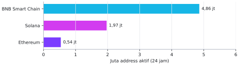
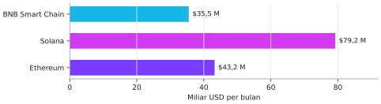

# 3 Keunggulan Platform

## 3.1 Prinsip Desain

| Prinsip | Implementasi pada Oxly |
|---|---|
| **Non-Kustodial** | Aset tetap berada di dompet pribadi pengguna atau terkunci di dalam smart contract escrow. Pemilik (owner) kontrak tidak memiliki otoritas untuk menarik dana escrow. Setiap order dapat dibatalkan kapan saja, dan dana escrow dikembalikan dalam transaksi yang sama. |
| **Sepenuhnya On-Chain** | Seluruh aktivitas order, pencocokan (matching), dan pembatalan tercatat sebagai transaksi on-chain yang dapat diverifikasi secara publik oleh siapa saja. |
| **Terbuka (Permissionless)** | Listing token terbuka bagi siapa saja melalui peninjauan otomatis, dan trading tidak memerlukan akun maupun KYC. Pencocokan order dijalankan oleh operator yang dikelola Oxly, yang hanya dapat menyelesaikan dana kepada kedua pihak yang bertransaksi dan penerima biaya. |
| **Pengalaman Setara CEX** | Menyediakan order book secara real-time, struktur biaya maker/taker, dukungan limit dan market order, grafik analitik profesional, serta aliran data WebSocket real-time. |
| **Aksesibilitas Tinggi** | Mendukung antarmuka web dan aplikasi mobile, autentikasi melalui dompet maupun kode QR, serta trading tanpa biaya gas pada jaringan BNB Smart Chain menggunakan OXG. |
| **Insentif yang Selaras** | Supply maksimal tetap, mint sesuai kebutuhan utilitas, serta mekanisme buyback & burn yang didanai pendapatan protokol mengikat dinamika supply token secara langsung dengan tingkat adopsi platform. |

## 3.2 Perbandingan Arsitektur Oxly

| Parameter | Bursa Terpusat (CEX) | DEX Berbasis AMM | Oxly |
|---|---|---|---|
| Penyimpanan Aset | Operator Bursa | Pengguna | Pengguna (smart contract escrow) |
| Limit Order | Ya | Tidak (atau melalui add-on) | Ya, bawaan (native) |
| Order Book & Kedalaman Pasar | Ya | Tidak | Ya, sepenuhnya on-chain |
| Mekanisme Penentuan Harga | Trader | Kurva rumus pool | Trader |
| Verifikasi Settlement | Tidak | Ya | Ya |
| Trading Tanpa Token Gas | Ya | Tidak | Ya, pada jaringan BSC (OXG) |
| Kewajiban KYC / Registrasi Akun | Wajib | Tidak | Tidak |
| Dukungan Multi-Chain | Ya | Terpisah per deployment | BSC, Ethereum, dan Solana |
| Distribusi Nilai Pendapatan ke Token | Jarang mengikat | Bervariasi | 80% biaya trading spot dialokasikan untuk buyback & burn |

## 3.3 Penerapan Langsung pada Jaringan Utama (Built Where Liquidity Resides)

Oxly tidak mengharuskan pengguna bermigrasi ke jaringan blockchain baru. Sebaliknya, Oxly menghadirkan infrastruktur order book on-chain secara langsung ke tiga ekosistem utama tempat mayoritas trader on-chain telah menyimpan aset mereka.

<figure><figcaption>
Address aktif 24 jam per jaringan, 9 November 2026 (juta) [5][8]
</figcaption></figure>

<figure><figcaption>
Volume spot DEX per jaringan, September 2026 (miliar USD) [6][8]
</figcaption></figure>

Secara kolektif, ketiga jaringan ini menguasai sekitar tiga perempat dari total volume perdagangan spot DEX global [7], dengan akumulasi ±7,4 juta alamat aktif (active addresses) dan volume transaksi spot mencapai ±$158 miliar per bulan. Saat ini, hampir seluruh volume tersebut dieksekusi melalui liquidity pool berbasis AMM. Oxly menyediakan infrastruktur order book dengan dukungan limit order serta penetapan harga maker/taker bagi basis pengguna yang sama—menggunakan dompet dan aset yang sudah ada—tanpa memerlukan proses bridging, jaringan baru, maupun pembuatan dompet tambahan.

Pendekatan ini menjadi pembeda fundamental dibandingkan protokol order book yang beroperasi di atas app-chain atau jaringan khusus tersendiri, di mana pengguna diwajibkan memindahkan dana melalui bridge ke ekosistem terpisah sebelum dapat memulai aktivitas trading.
