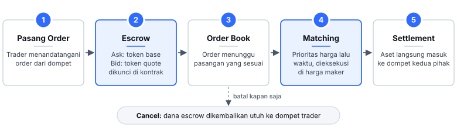

# 5 Mekanisme Exchange

## 5.1 Siklus Hidup Order

<figure><figcaption><p></p></figcaption></figure>

```
orderId = keccak256(sender, baseToken, quoteToken, side, price, amount, nonce, expiresAt)
```

Mengubah parameter apa pun menghasilkan ID berbeda, sehingga order tidak bisa diubah setelah dipasang.

| Properti | Nilai |
|---|---|
| Jenis order | Limit, Market |
| Masa berlaku | 1 sampai 365 hari (default 30 hari) |
| Status | OPEN → PARTIAL → FILLED, atau CANCELLED |
| Validasi | Jumlah dan nilai minimum per market; harga dan jumlah kelipatan tick |
| Order market | Harga dari rata-rata tertimbang volume level order book yang dibutuhkan |
| Token yang ditolak | Token fee-on-transfer, karena tidak bisa di-escrow secara tepat |

## 5.2 Mekanisme Pencocokan (Matching) dan Penyelesaian (Settlement)

Matching engine memasangkan order yang beririsan (crossing orders) berdasarkan prioritas harga dan waktu pemasangan (price-time priority). Order yang tercatat lebih awal di dalam order book berperan sebagai maker, sedangkan order yang masuk berikutnya berperan sebagai taker, dengan eksekusi transaksi diselesaikan pada harga maker.

Operator mengirimkan data pencocokan order ke smart contract melalui fungsi `matchOrders`. Sebelum melakukan perpindahan aset, smart contract memvalidasi kesesuaian harga, kuantitas, serta batas maksimal biaya transaksi secara ketat.

Operator tidak memiliki wewenang maupun celah teknis untuk mengalihkan dana pengguna. Fungsi `matchOrders` secara eksklusif hanya dapat mendistribusikan penyelesaian aset kepada kedua pihak yang bertransaksi serta alamat penerima biaya protokol. Apabila terdapat sisa dana escrow pada order beli yang telah terisi penuh, dana tersebut secara otomatis dikembalikan kepada pembeli.

## 5.3 Struktur Biaya Trading

| Kategori | Tarif | Denominasi Pembayaran |
|---|---|---|
| Maker | 0,1% | Aset token yang diterima trader |
| Taker | 0,1% | Aset token yang diterima trader |
| Batas Maksimal Kontrak | 1% per sisi | — |

Secara operasional, penjual membayarkan biaya transaksi dalam token quote (misalnya USDT), sedangkan pembeli membayarkan biaya dalam token base. Pemegang stake pada fitur Oxly Gas Staking berhak memperoleh potongan biaya trading sebesar 5% hingga 100% pada jaringan BNB Smart Chain.

## 5.4 Mekanisme Keamanan Pengiriman Token Native

Apabila alamat penerima menolak transfer token native—misalnya akibat penggunaan dompet smart contract yang tidak mengimplementasikan fungsi receive—smart contract protokol secara otomatis mengonversi dan mengirimkan aset dalam bentuk token wrapped (seperti WBNB). Mekanisme fallback ini memastikan bahwa satu alamat penerima yang bermasalah tidak dapat memblokir maupun menggagalkan proses eksekusi match atau pembatalan order (anti-DoS).

## 5.5 Struktur Biaya Gas bagi Trader

Trader hanya menanggung biaya gas untuk transaksi yang mereka inisiasi sendiri, sedangkan biaya gas untuk eksekusi pencocokan order (matching) sepenuhnya ditanggung oleh operator. Pada jaringan BNB Smart Chain (berdasarkan acuan harga gas 0,05 gwei dan harga BNB sebesar $557 per 22 November 2026 [9][10]), penempatan order memerlukan konsumsi gas sekitar 138.000–212.000 unit (±$0,004–$0,006), sementara pembatalan order memerlukan sekitar 62.000–66.000 unit gas (±$0,002).

Melalui pemanfaatan Oxly Gas (OXG), beban biaya gas tersebut menjadi 0 BNB, kecuali untuk transaksi order yang mengunci BNB native ke dalam escrow. Setiap jenis token memerlukan otorisasi persetujuan (approval) satu kali sebelum transaksi pertamanya; dengan OXG, token yang mendukung standar `permit` dapat diotorisasi langsung melalui tanda tangan kriptografis di dalam pesan order. Rincian estimasi konsumsi gas per operasi tercantum secara lengkap pada Lampiran C.

### Simulasi Rincian Biaya Transaksi: Pembelian Token Senilai 100 USDT pada Jaringan BNB Smart Chain

| Komponen Biaya | Pembayaran Gas dengan BNB | Pembayaran Gas dengan OXG |
|---|---:|---:|
| Biaya Gas Penempatan Order Beli | $0,0050 | 0 BNB |
| Biaya Gas Eksekusi Matching | $0 | $0 |
| Biaya Trading 0,1% (dalam token yang diterima) | $0,10 | $0,10 |
| **Total Estimasi Biaya** | **≈ $0,1050** | **≈ $0,10** |
| Total dengan Diskon Staking Tier 3 (potongan biaya −25%) | ≈ $0,0800 | ≈ $0,075 |

*Data order dipadatkan ke 6 slot storage (bukan 13), menghemat ±140.000 gas di setiap order.*

## 5.6 Mekanisme Autentikasi dan Manajemen Sesi

* **Autentikasi Berbasis Dompet (Wallet Login):** Pengguna menandatangani pesan autentikasi sekali pakai (cryptographic nonce) menggunakan dompet pribadi mereka untuk memperoleh token sesi. Proses ini sepenuhnya menghilangkan kebutuhan akan registrasi akun terpusat, kata sandi (password), maupun verifikasi KYC.
* **Autentikasi Lintas Perangkat via Kode QR (Mobile-to-Web QR Login):** Antarmuka web menampilkan kode QR yang dipindai melalui aplikasi mobile Oxly. Kedua perangkat melakukan pertukaran kunci kriptografis menggunakan protokol ECDH P-256 untuk membentuk shared secret, lalu mengirimkan kunci sesi yang telah dienkripsi dengan standar AES-GCM 256 melalui session relay Oxly—di mana relay hanya bertindak sebagai penerus paket data terenkripsi (zero-knowledge relay) tanpa dapat membaca isi kunci sesi. Seluruh penempatan order yang diinisiasi melalui sesi QR dieksekusi menggunakan relayer OXG tanpa membebankan biaya gas langsung kepada pengguna.
