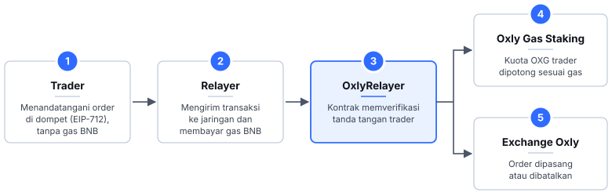

# 6 Mekanisme Trading Tanpa Gas: Oxly Gas (OXG)

## 6.1 Konsep Dasar

Oxly Gas (OXG) merupakan alokasi kuota gas yang terisi ulang secara berkelanjutan (regenerative gas quota) pada jaringan BNB Smart Chain. Pengguna memperoleh kapasitas OXG dengan melakukan staking token OXLY pada kontrak Oxly Gas Staking, di mana setiap 1 OXG setara dengan 1 unit gas.

Secara arsitektural, OXG bukan merupakan aset token yang dapat diperdagangkan maupun dipindahtangankan antar-dompet; kuota ini bersifat non-transferable dan secara eksklusif hanya dapat digunakan untuk mengeksekusi transaksi order milik pengguna sendiri atau didelegasikan kepada alamat lain yang ditunjuk.

<figure><figcaption><p></p></figcaption></figure>

## 6.2 Model Kapasitas dan Regenerasi

| Parameter | Ketentuan Protokol |
|---|---|
| Periode Warm-Up | Saldo stake baru mulai menghasilkan kapasitas OXG setelah melewati periode tunggu selama **14 hari**. |
| Penarikan (Unstake) | Dapat dilakukan kapan saja secara instan, kecuali untuk porsi stake yang sedang berstatus didelegasikan. |
| Kapasitas Maksimal | `Stake Aktif × capPerOxly` per siklus 24 jam, langsung tersedia secara penuh setelah masa warm-up selesai. |
| Mekanisme Pemulihan | Kapasitas OXG yang terpakai beregenerasi secara linear sebesar **1/24 dari total kapasitas setiap jam**, dan kembali penuh dalam 24 jam. |
| Tingkat Alokasi (Rate) | `capPerOxly = min(baseRate, dailyBudget ÷ totalActiveStake)` |

Tingkat alokasi (rate) bersifat konstan selama total stake aktif berada di bawah titik jenuh (saturation point). Apabila total stake aktif melampaui batas tersebut, anggaran gas harian didistribusikan secara proporsional sehingga total kapasitas protokol tidak pernah melebihi batas anggaran harian yang ditetapkan. Perhitungan kapasitas hanya menyertakan stake yang telah melewati periode warm-up guna mencegah eksploitasi flash-staking yang dapat mengencerkan alokasi pengguna lain.

## 6.3 Konsumsi OXG per Jenis Operasi

| Jenis Operasi | Konsumsi OXG | Nilai Ekuivalen Gas (USD) | Biaya Alternatif dalam OXLY<br>(Asumsi 1 OXLY = $0,01) |
|---|---:|---:|---:|
| Penempatan Order Jual | 230.000 | $0,0064 | 0,64 OXLY |
| Penempatan Order Beli | 240.000 | $0,0067 | 0,67 OXLY |
| Pembatalan Order (Cancel) | 115.000 | $0,0032 | 0,32 OXLY |
| Otorisasi Token via Permit (Tambahan) | +20.000 | +$0,0006 | +0,06 OXLY |

*Catatan: Estimasi nilai dihitung berdasarkan acuan harga gas jaringan sebesar 0,05 gwei dan harga BNB sebesar $557 per 22 November 2026 [9][10]. Selama saldo kapasitas OXG mencukupi, trader tidak dikenakan biaya apa pun.*

## 6.4 Mekanisme Penanganan Kekurangan Kapasitas (OXG Shortfall)

Apabila kapasitas OXG pengguna tidak mencukupi saat transaksi dikirimkan, order tetap dieksekusi tanpa kegagalan sistem. Selisih kekurangan kapasitas otomatis dibayarkan menggunakan token OXLY dengan formula:

```
Biaya Kekurangan = Kekurangan OXG × feePerGas
```

Dalam setiap pesan order, trader menandatangani parameter batas harga maksimal (`maxFeePerGas`) secara kriptografis sehingga relayer tidak pernah dapat menagih biaya melebihi batas yang disetujui pengguna. **Seluruh token OXLY yang dibayarkan dari mekanisme kekurangan kapasitas ini akan di-burn secara permanen.**

## 6.5 Delegasi Kapasitas OXG

Pemilik stake dapat mendelegasikan kapasitas OXG mereka kepada alamat eksternal—seperti bot trading algoritmik, dompet sekunder, maupun anggota tim—dengan durasi fleksibel mulai dari 1 jam hingga 30 hari yang akan berakhir secara otomatis.

* **Batas Kuota Delegasi:** Maksimal 10 delegasi masuk dan 10 delegasi keluar per alamat dompet, dengan ambang batas minimal sebesar 1.000 OXLY per delegasi.
* **Kepemilikan & Hak Tier:** Token OXLY yang kapasitasnya didelegasikan tetap terkunci di dalam akun pemilik asli dan tetap diperhitungkan dalam penentuan tier diskon biaya trading pemilik tersebut. Pihak penerima delegasi memiliki hak penuh untuk menolak delegasi yang masuk.

## 6.6 Sumber Pendanaan dan Kontrol Anggaran

Biaya gas BNB yang dikeluarkan oleh relayer sepenuhnya didanai melalui alokasi **EGF – Gas Subsidy** sebesar 20.000.000 OXLY, dengan batas mint (minting cap) maksimal sebesar **1.000.000 OXLY per periode 30 hari** yang dikunci di dalam smart contract token. Anggaran gas harian disesuaikan secara dinamis mengikuti pertumbuhan aktivitas jaringan tanpa melampaui batas bulanan tersebut. Pendapatan biaya trading protokol tidak pernah digunakan untuk mensubsidi biaya gas.

## 6.7 Ruang Lingkup Cakupan OXG

Fasilitas OXG secara khusus mencakup operasi **penempatan dan pembatalan order pada jaringan BNB Smart Chain**. Interaksi administratif lainnya—seperti aktivitas staking, unstaking, delegasi kapasitas, klaim reward staking, serta klaim airdrop—tetap menggunakan token gas native jaringan (BNB). Untuk aktivitas perdagangan pada jaringan Ethereum dan Solana, biaya gas ditanggung secara mandiri oleh masing-masing trader.
