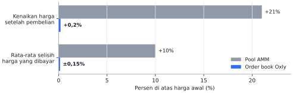
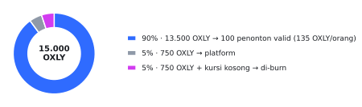

# 7 Ekosistem Produk

## 7.1 Perdagangan Spot (Spot Trading)

Antarmuka perdagangan spot Oxly dirancang untuk menghadirkan fungsionalitas terminal bursa institusional di atas infrastruktur on-chain:

* **Eksekusi Order dan Manajemen Alokasi:** Mendukung penempatan limit order maupun market order yang dilengkapi dengan pengatur alokasi saldo (balance slider) dari 0% hingga 100%.
* **Visualisasi Kedalaman Order Book:** Menampilkan kedalaman pasar secara real-time dengan fitur agregasi level harga (tick grouping), indikator spread, rasio bid/ask, serta interaksi klik harga langsung untuk mengisi formulir order secara otomatis.
* **Perangkat Grafik Analitik:** Terintegrasi penuh dengan grafik TradingView (candlestick dan indikator teknikal real-time) serta grafik kedalaman pasar (market depth chart).
* **Manajemen Transaksi dan Navigasi Pasar:** Menyediakan pemantauan riwayat transaksi terbaru, daftar order aktif (open orders), riwayat order dan eksekusi, ringkasan portofolio, daftar pantauan favorit, pencarian pasangan pasar, serta indeks pergerakan harga tertinggi (top gainers/losers).

## 7.2 Kontrak Berjangka: Perpetual Futures Bermargin USDT

Oxly menyediakan instrumen perdagangan perpetual futures bermargin USDT yang beroperasi di atas infrastruktur derivatif terdesentralisasi. Seluruh jaminan margin USDT disetorkan langsung ke dalam vault smart contract pada jaringan asal pengguna—bukan ke dompet kustodian bursa. Saldo margin dan posisi terbuka dicatat pada buku besar on-chain (on-chain ledger) yang dapat diaudit secara publik oleh siapa saja, sementara setiap penarikan dana diproses secara eksklusif berdasarkan tanda tangan kriptografis pengguna. Sistem futures Oxly dilengkapi dengan mekanisme perhitungan harga indeks (index price) dan harga wajar (mark price), mesin likuidasi otomatis, dana asuransi (insurance fund), serta pool likuiditas futures mandiri milik protokol Oxly.

| Parameter Spesifikasi | Ketentuan Protokol |
|---|---|
| Instrumen Kontrak | Perpetual futures bermargin USDT tanpa tanggal kedaluwarsa (no expiration) |
| Batas Leverage | Hingga **1000x**, disesuaikan secara dinamis berdasarkan tier risiko ukuran posisi dan kedalaman likuiditas pasar |
| Mode Margin & Posisi | Cross margin dan isolated margin per pasangan aset (symbol) · mode posisi satu arah (one-way mode) |
| Mekanisme Funding Rate | Siklus setiap 8 jam (00:00, 08:00, dan 16:00 UTC); rate positif berarti posisi long membayarkan biaya pendanaan kepada posisi short |
| Tipe Order & Parameter Eksekusi | Limit, Market, Stop Limit, Stop Market, Take Profit / Stop Loss (TP/SL), Reduce-Only, Post-Only, serta instruksi waktu Good-Til-Canceled (GTC), Immediate-or-Cancel (IOC), dan Fill-or-Kill (FOK) |
| Struktur Biaya | Tarif biaya maker/taker khusus futures Oxly yang dipublikasikan secara transparan pada antarmuka platform |

### Struktur Tier Risiko dan Parameter Margin (Ilustrasi Pasar BTC)

| Tier Risiko | Batas Nilai Posisi (USDT) | Leverage Maksimal | Rasio Maintenance Margin (MMR) |
|---|---:|---:|---:|
| 1 | ≤ 5.000 | 1000x | 0,05% |
| 2 | ≤ 50.000 | 500x | 0,10% |
| 3 | ≤ 250.000 | 200x | 0,25% |
| 4 | ≤ 1.000.000 | 100x | 0,50% |
| 5 | ≤ 5.000.000 | 50x | 1,00% |
| 6 | ≤ 20.000.000 | 20x | 2,50% |
| 7 | ≤ 50.000.000 | 10x | 5,00% |
| 8 | ≤ 200.000.000 | 5x | 10,00% |

### Formula Perhitungan Margin, PnL, dan Funding

| | Nama | Rumus |
|---|---|---|
| **IM** | ****Margin Awal**** *Initial Margin* | IM = (Nilai Posisi) ÷ Leverage |
| **MM** | ****Margin Pemeliharaan**** *Maintenance Margin* | MM = (Nilai Posisi × MMR) − *maintenanceAmount* |
| **uPnL** | ****Laba/Rugi Belum Terealisasi**** *Unrealized PnL* | uPnL = (Harga Mark − Harga Entry) × Ukuran Posisi × *dir* |
| **ROE** | ****Imbal Hasil Ekuitas**** *Return on Equity* | ROE = uPnL ÷ ((Harga Entry × Ukuran Posisi) ÷ Leverage) |
| **FP** | ****Pembayaran Biaya Pendanaan**** *Funding Payment* | FP = −*dir* × Ukuran Posisi × Harga Mark × *fundingRate* |

*Keterangan: *dir* = +1 untuk posisi long, dan *dir* = −1 untuk posisi short.*

## 7.3 Mekanisme Listing Token (Permissionless Listing)

| Parameter | Ketentuan Protokol |
|---|---|
| Biaya Listing | Sebesar **50.000 OXLY**, dibayarkan pada jaringan BNB Smart Chain melalui smart contract `ListingManager` (besaran tarif dapat disesuaikan oleh pemilik/owner protokol). |
| Dukungan Jaringan | BNB Smart Chain, Ethereum, atau Solana, dipilih sesuai dengan jaringan native token oleh pihak pengembang (developer). |
| Otoritas Pengajuan | Terbuka bagi siapa saja (permissionless). Apabila pengaju bukan merupakan alamat pemilik (deployer/owner) kontrak token, profil proyek akan ditandai sebagai "Belum Terverifikasi" hingga tim resmi token melakukan proses klaim kepemilikan. |
| Mekanisme Peninjauan (Review) | Berjalan secara **otomatis penuh** (automated security & parameter check), dengan hasil validasi yang dicatat secara permanen di on-chain. |
| Aktivasi Pasar (Market Creation) | Apabila pengajuan lolos validasi, pasangan pasar (trading pair) dibuat secara otomatis dengan penentuan tick size yang dikalibrasi berdasarkan harga pasar token terkini. |
| Kebijakan Refund & Alokasi Biaya | Biaya listing bersifat tidak dapat dikembalikan (non-refundable). Sebesar 50% di-burn secara permanen, sedangkan 50% dialokasikan untuk kebutuhan operasional protokol. |

### Kriteria Audit Otomatis (Automated Token Security Screening)

| Parameter Pemeriksaan | Token Berbasis EVM (BNB Smart Chain & Ethereum) | Token Berbasis Solana (SPL) |
|---|---|---|
| Kepatuhan Standar Fungsi | Fungsi standar ERC-20 merespons secara normal sesuai spesifikasi | Konfigurasi mint dan metadata SPL terverifikasi valid |
| Deteksi Honeypot | Simulasi eksekusi transaksi beli dan jual berhasil dilakukan | Simulasi eksekusi transaksi beli dan jual berhasil dilakukan |
| Batas Pajak Transaksi | Tarif pajak beli (buy tax) dan pajak jual (sell tax) ≤ 10% | Biaya transfer (transfer fee) ≤ 10% |
| Integritas Mekanisme Transfer | Tidak mengandung mekanisme pemotongan tersembunyi (fee-on-transfer) | Tidak menggunakan transfer hook yang memodifikasi maupun memblokir transfer |
| Transparansi Otoritas Kontrak | — | Status mint authority dan freeze authority diungkapkan secara terbuka; freeze authority tidak diizinkan untuk membekukan saldo pemegang token (holder) |

### Mekanisme Listing Mandiri (Self-Listing)

| Parameter | Bursa Terpusat (CEX) | DEX Berbasis AMM | Oxly |
|---|---|---|---|
| Otoritas Persetujuan | Tim internal bursa | Siapa saja (permissionless) | Siapa saja (melalui audit otomatis) |
| Struktur Biaya | Berdasarkan negosiasi, umumnya sangat tinggi | Hanya biaya gas jaringan | 50.000 OXLY (ditetapkan transparan di awal) |
| Arsitektur Pasar | Order book | Liquidity pool | Order book penuh |
| Kebutuhan Likuiditas untuk Price Impact Rendah | Disediakan oleh market maker | Besar, memerlukan pasangan dua aset | Minimal, terkonsentrasi di sekitar harga pasar |
| Paparan Impermanent Loss | Tidak ada | Ya | Tidak ada |
| Kendali Level Harga | Dikelola oleh market maker bursa | Tidak ada (ditentukan oleh kurva rumus) | Kendali penuh oleh penyedia likuiditas |

### Efisiensi Modal pada Arsitektur Order Book

Secara struktural, protokol AMM mendistribusikan likuiditasnya ke seluruh rentang spektrum harga yang mungkin terjadi (dari 0 hingga ∞), sehingga hanya sebagian kecil dari total modal yang benar-benar aktif berada di sekitar titik harga pasar saat ini. Sebaliknya, pada arsitektur order book Oxly, pengembang proyek maupun penyedia likuiditas dapat menempatkan order secara terfokus tepat pada zona harga di mana aktivitas perdagangan berlangsung.

(Sebagai ilustrasi perbandingan, pada kondisi total likuiditas yang sama sebesar $10.000 dengan volume transaksi pembelian sebesar $1.000—rincian simulasi dampak harga disajikan berikut ini):

| Parameter | Pool AMM | Order Book Oxly |
|---|---|---|
| Likuiditas yang Disediakan | $10.000 USDT + token senilai sama (constant product) | Order jual $10.000, tersebar rata dari +0,1% s.d. +2,0% di atas harga |
| Kenaikan Harga Setelah Pembelian $1.000 | **+21%** | +0,2% |
| Rata-rata Harga yang Dibayar Pembeli | +10% di atas harga awal | ±0,15% di atas harga awal |

<figure><figcaption>
Simulasi dampak harga atas pembelian $1.000 dengan likuiditas $10.000 (%)
</figcaption></figure>

*Likuiditas order book hanya ada di tempat order dipasang, sehingga proyek atau market maker perlu memperbarui ordernya saat harga bergerak.*

## 7.4 Ekosistem Siaran Langsung: Oxly Live

| Parameter | Live Developer | Live Komunitas |
|---|---|---|
| Penyelenggara (Host) | Pengembang proyek atau tim resmi token | Pengguna umum, KOL, maupun influencer (melalui proses persetujuan) |
| Biaya Penyelenggaraan | **15.000 OXLY** (dibayarkan ke treasury Oxly pada jaringan BNB Smart Chain) | Gratis (tanpa biaya) |
| Durasi & Kapasitas Pembicara | Maksimal 120 menit · 1 host utama + hingga 2 co-host | Maksimal 120 menit · 1 host utama + hingga 2 co-host |
| Penerima Distribusi Reward OXLY | **100 penonton dengan akumulasi durasi menonton (watch time) terlama** | Host utama, apabila ambang batas target jumlah penonton tercapai |

### Mekanisme Distribusi dan Validasi Oxly Live

<figure><figcaption>
Pembagian 15.000 OXLY Live Developer
</figcaption></figure>

* **Distribusi Dana Live Developer:** Dari biaya sebesar 15.000 OXLY, **90% (13.500 OXLY)** didistribusikan secara merata oleh platform kepada maksimal 100 penonton valid (**135 OXLY per penonton**) dan dikirim langsung ke dompet penerima tanpa proses klaim manual. Sebesar 5% dialokasikan untuk pendapatan platform, sedangkan sisa 5% ditambah seluruh alokasi kuota penonton yang tidak terisi di-burn secara permanen. Biaya dikembalikan 100% (full refund) apabila pengajuan ditolak atau siaran dibatalkan sebelum jadwal dimulai.
* **Struktur Insentif Live Komunitas:** Reward untuk host utama dihitung berdasarkan formula `Jumlah Penonton Valid × 10 OXLY × Pengali Tier` (×1, ×1,5, atau ×2,5), yang didanai dari anggaran ekosistem sebesar 500.000 OXLY per bulan selama periode dua tahun.
* **Pembagian Fitur Gift:** Apresiasi digital (gift) dibayarkan dalam OXLY dengan pembagian 95% untuk host dan 5% untuk platform.
* **Kriteria Penonton Valid:** Peserta dikategorikan valid apabila telah menghubungkan dompet on-chain beserta akun X, menonton minimal 50% dari total durasi siaran (diverifikasi melalui sinyal heartbeat pada tab peramban yang aktif), serta tidak berstatus sebagai host dalam sesi tersebut.

## 7.5 Aplikasi Mobile (Native Mobile Client)

* **Dompet Self-Custody Terintegrasi:** Tersedia secara native untuk perangkat iOS dan Android, di mana kunci privat (private keys) dibuat dan disimpan secara lokal di dalam perangkat pengguna, serta mendukung impor dompet eksisting.
* **Akses Perdagangan Multi-Chain Penuh:** Mendukung eksekusi perdagangan penuh di seluruh jaringan yang terintegrasi, dilengkapi fasilitas trading tanpa biaya gas pada jaringan BNB Smart Chain melalui pemanfaatan OXG.
* **Integrasi Ekosistem & Autentikasi Lintas Perangkat:** Memungkinkan proses masuk (login) ke antarmuka web melalui pemindaian kode QR tanpa memerlukan ekstensi peramban (browser extension), sekaligus menyediakan akses terpadu ke manajemen portofolio, staking, klaim airdrop, dan fitur Oxly Live.
