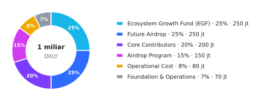
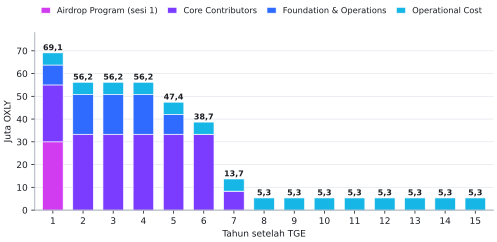

# 9 Tokenomics

## 9.1 Alokasi

<figure><figcaption>
Alokasi supply maksimal 1.000.000.000 OXLY
</figcaption></figure>

| Alokasi | Porsi | OXLY |
|---|---:|---:|
| Ecosystem Growth Fund (EGF) | 25% | 250 jt |
| Future Airdrop | 25% | 250 jt |
| Core Contributors | 20% | 200 jt |
| Airdrop Program | 15% | 150 jt |
| Operational Cost | 8% | 80 jt |
| Foundation & Operations | 7% | 70 jt |
| **Total** | **100%** | **1.000 jt** |

### Jadwal Rilis dan Distribusi Alokasi (Release & Vesting Schedule)

| Pos Alokasi | Mekanisme Rilis (Release Schedule) |
|---|---|
| Ecosystem Growth Fund (EGF) | Di-mint sesuai realisasi klaim program (per klaim, lihat Bab 9.2) |
| Future Airdrop | Tidak di-mint saat TGE; dialokasikan secara eksklusif untuk program airdrop kepada pengguna di masa mendatang (lihat Bab 9.4) |
| Core Contributors | Periode cliff selama 6 bulan, dilanjutkan dengan 24 tranche pelepasan per kuartal mulai dari bulan ke-6 hingga bulan ke-75 |
| Airdrop Program | Terbagi dalam 8 sesi dengan kuota tetap; Sesi 1 berlangsung selama 3 bulan sejak TGE, sementara jadwal sesi berikutnya diumumkan secara terpisah |
| Operational Cost | Pelepasan linear per detik (continuous linear vesting) sejak TGE selama periode 15 tahun |
| Foundation & Operations | Periode cliff selama 6 bulan, dilanjutkan dengan pelepasan linear selama 48 bulan |

## 9.2 Sub-Alokasi Ecosystem Growth Fund (EGF)

Alokasi Ecosystem Growth Fund (EGF) dipartisi secara langsung di dalam arsitektur smart contract token menjadi tiga sub-alokasi terpisah, di mana masing-masing memiliki batas kuota dan otoritas minter independen. Pemisahan on-chain ini menjamin bahwa alokasi anggaran untuk satu program ekosistem tidak pernah dapat digabungkan maupun dialihkan untuk mendanai program lainnya.

| Sub-alokasi | OXLY | Kegunaan | Batas |
|---|---:|---|---|
| Staking Reward | 200 jt | Reward Oxly Staking | Maks. 40 jt per tahun |
| Gas Subsidy | 20 jt | Gas relay OXG di BNB Smart Chain | Maks. 1 jt per 30 hari |
| LP & New Products | 30 jt | Live Komunitas (≤ 12 jt, dua tahun), insentif likuiditas (≥ 18 jt) | Live 500 rb per bulan |
| **Total** | **250 jt** |   |   |

## 9.3 Tata Kelola dan Aturan Mint (Minting Governance)

Pada saat deployment awal, supply beredar token OXLY bernilai nol. Smart contract token menyimpan batas kuota maksimal serta penghitung akumulasi mint (minted) untuk masing-masing pos alokasi secara terpisah; setiap permintaan mint akan otomatis ditolak (revert) apabila kondisi `minted + jumlah > kuota` terpenuhi.

* **Otorisasi Minter Terdaftar:** Hanya alamat minter yang terdaftar secara resmi yang memiliki hak untuk melakukan mint dari pos alokasinya masing-masing.
* **Penguncian Permanen Alokasi Berjadwal:** Alamat minter untuk seluruh pos alokasi berjadwal (vesting) dikunci secara permanen (immutable) dan tidak dapat diubah oleh siapa pun.
* **Kontrol Multisig pada Pos Dinamis:** Otoritas minter untuk sub-alokasi Ecosystem Growth Fund (EGF) dan pos Future Airdrop dikelola melalui dompet multisig pemilik (owner) protokol, namun tetap terikat secara mutlak pada batas kuota maksimal masing-masing pos.
* **Sifat Deflasi Permanen:** Setiap token OXLY yang telah di-burn dihapus dari peredaran secara permanen dan tidak pernah dikembalikan ke dalam kuota mint mana pun.

## 9.4 Ketentuan Alokasi Future Airdrop

Alokasi Future Airdrop sebesar 250.000.000 OXLY merupakan bagian integral dari porsi komunitas sebesar 65% dan diatur di bawah batasan tata kelola yang ketat:

* **Peruntukan Eksklusif Komunitas:** Dana pada pos ini secara eksklusif hanya dapat digunakan untuk program distribusi airdrop kepada pengguna protokol.
* **Aktivasi Minter Berbasis Program:** Otoritas minter hanya ditetapkan sementara oleh multisig owner pada saat program airdrop aktif dijalankan.
* **Transparansi Publik Pra-Rilis:** Setiap rencana pelepasan maupun distribusi alokasi wajib diumumkan secara terbuka kepada publik sebelum transaksi eksekusi dijalankan.
* **Batas Keras On-Chain (Hard Cap):** Total mint dibatasi secara mutlak pada angka 250.000.000 OXLY oleh smart contract, dan seluruh kuota tersebut tidak wajib di-mint sepenuhnya apabila tidak dialokasikan untuk program distribusi komunitas.

## 9.5 Jadwal Vesting

| Alokasi | Penerima | Cliff | Pola | Selesai |
|---|---|---|---|---|
| Core Contributors | Multisig tim | 6 bulan | 24 tranche ±8,33 jt tiap 3 bulan (bulan 6–75) | Bulan 75 (Feb 2033) |
| Foundation & Operations | Multisig foundation | 6 bulan | Linear per detik 48 bulan (±1,46 jt/bulan) | Bulan 54 (Mei 2031) |
| Operational Cost | Dompet operasional | — | Linear per detik 180 bulan (±444 rb/bulan) | Tahun 15 (Nov 2041) |
| Airdrop Program | Pengguna yang memenuhi syarat | — | 8 sesi; sesi 1 sejak TGE, sesi 2–8 saat diumumkan | Saat ke-8 sesi selesai |

## 9.6 Emisi Terjadwal per Tahun

<figure><figcaption>
Emisi maksimal alokasi berjadwal (juta OXLY). Airdrop sesi 2–8 (total 120 jt) tidak terjadwal; masing-masing hanya menambah paling banyak sebesar kuotanya saat diumumkan dan dijalankan.
</figcaption></figure>

| Aliran berbasis klaim (tambahan) | Batas atas |
|---|---|
| Reward staking | ≤ 40 jt per tahun, hanya jika total stake > 166,7 jt |
| Gas Subsidy | ≤ ±12,2 jt per tahun |
| LP & New Products | Total 30 jt; Live Komunitas ≤ 6 jt per tahun selama dua tahun |

Alokasi reward airdrop yang tidak diklaim serta kuota emisi staking yang tidak terpakai **tidak akan pernah di-mint**. Dengan demikian, realisasi emisi bersih aktual senantiasa berada pada tingkat yang sama atau lebih rendah dari proyeksi maksimal di atas, dan terus tereduksi lebih lanjut melalui mekanisme burn token.

## 9.7 Tahapan Rilis Supply Beredar (Circulating Supply Schedule)

| Linimasa / Periode | Peristiwa dan Proyeksi Supply Beredar |
|---|---|
| **TGE (28 November 2026)** | ≈ 0 OXLY beredar; pelepasan linear Operational Cost mulai berjalan pada laju ±14.800 OXLY per hari. |
| **Bulan ke-3 (Februari 2027)** | Periode distribusi Airdrop Sesi 1 berakhir (±30.000.000 OXLY); total estimasi beredar mencapai ±32.000.000 OXLY. |
| **Bulan ke-6 (Mei 2027)** | Pelepasan tranche kuartalan pertama untuk Core Contributors; jadwal pelepasan linear Foundation & Operations resmi dimulai. |
| **Bulan ke-54 (Mei 2031)** | Seluruh periode vesting alokasi Foundation & Operations selesai (70.000.000 OXLY). |
| **Bulan ke-75 (Februari 2033)** | Seluruh periode vesting alokasi Core Contributors selesai (200.000.000 OXLY). |
| **Tahun ke-15 (November 2041)** | Seluruh periode pelepasan linear alokasi Operational Cost selesai (80.000.000 OXLY). |

## 9.8 Peluncuran yang Adil (Fair Launch) dan Penemuan Harga (Price Discovery)

Token OXLY diluncurkan tanpa putaran presale, tanpa alokasi likuiditas hasil pre-mint, serta tanpa penetapan maupun intervensi harga awal yang didanai oleh tim internal. Seluruh unit OXLY pertama yang masuk ke dalam peredaran berasal secara murni dari klaim airdrop oleh pengguna aktif dan pelepasan linear Operational Cost, di mana valuasi serta pembentukan harga (price discovery) ditentukan sepenuhnya secara organik oleh mekanisme penawaran dan permintaan pasar di atas order book Oxly.
