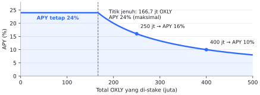

# 10 Staking

Oxly menyediakan dua produk staking yang beroperasi secara terpisah pada jaringan BNB Smart Chain. Setiap unit token OXLY hanya dapat dikunci (staked) pada salah satu kontrak dalam satu waktu, namun pengguna memiliki fleksibilitas penuh untuk membagi alokasi kepemilikan token mereka ke dalam kedua produk tersebut secara proporsional.

### Komparasi Produk Staking Oxly

| Parameter Spesifikasi | Oxly Staking | Oxly Gas Staking |
|---|---|---|
| Utilitas & Manfaat Utama | Perolehan reward token OXLY berbasis APY | Alokasi kapasitas gas OXG serta akses tier diskon biaya trading |
| Periode Penguncian (Lock-Up) | Tidak ada; aktivitas stake, penarikan (unstake), dan klaim reward dapat dilakukan kapan saja | Tidak ada periode penguncian penarikan; terdapat masa tunggu (warm-up) 14 hari sebelum kuota OXG dan diskon biaya aktif |
| Sumber Emisi Reward | Di-mint sesuai realisasi klaim (on-demand mint) dari alokasi EGF – Staking Reward | — (tidak menghasilkan emisi token) |
| Hak Diskon Biaya Trading | Tidak termasuk | Ya (sesuai tier jumlah stake aktif) |

## 10.1 Oxly Staking (APY)

| | Nama | Rumus |
|---|---|---|
| **APY** | ****Imbal Hasil Tahunan**** *Annual Percentage Yield* | APY = min( 24% , (40.000.000 OXLY per tahun) ÷ (Total OXLY yang di-stake) ) |

<figure><figcaption>
APY Oxly Staking terhadap total OXLY yang di-stake
</figcaption></figure>

* Reward bertambah **setiap detik**, bisa diklaim atau di-compound kapan saja.
* APY bertahan di **24%** sampai total stake mencapai 166,7 jt OXLY; di atasnya emisi tahunan dibagi bersama.
* Reward di-mint saat diklaim dari alokasi 200 jt; pada emisi penuh bertahan ±5 tahun, dan lebih lama karena emisi yang tidak terpakai tidak pernah di-mint.
* APY maksimal dan emisi tahunan bisa disesuaikan owner.

## 10.2 Oxly Gas Staking

Kontrak Oxly Gas Staking memiliki dua fungsi utama dalam ekosistem utilitas Oxly, yakni mengakumulasi alokasi kapasitas OXG untuk memfasilitasi eksekusi trading tanpa biaya gas (sebagaimana dijelaskan pada Bab 6) serta menjadi parameter penentu tier diskon biaya trading spot pada jaringan BNB Smart Chain.

| Tier | Jumlah Stake Aktif Minimal | Nilai Ekuivalen (Asumsi 1 OXLY = $0,01) | Diskon Biaya Trading |
|---|---:|---:|---:|
| 1 | 10.000 OXLY | $100 | 5% |
| 2 | 50.000 OXLY | $500 | 10% |
| 3 | 250.000 OXLY | $2.500 | 25% |
| 4 | 1.000.000 OXLY | $10.000 | 50% |
| 5 | 10.000.000 OXLY | $100.000 | 100% (bebas biaya / zero fee) |

Ambang batas (threshold) untuk setiap tier ditetapkan dalam denominasi token OXLY dan dapat disesuaikan oleh pemilik (owner) protokol dengan batas maksimal sebanyak 5 tier. Perhitungan kualifikasi hanya menyertakan saldo stake aktif yang telah melewati periode tunggu (warm-up), sementara alokasi stake yang kapasitas OXG-nya sedang didelegasikan kepada pihak lain tetap diperhitungkan sebagai hak pemilik asli. Secara khusus, Tier 5 dirancang bagi penyedia likuiditas institusional (market maker), memberikan pembebasan biaya trading sepenuhnya sebagai insentif atas penguncian (staking) sebesar 1% dari total supply maksimal OXLY.
