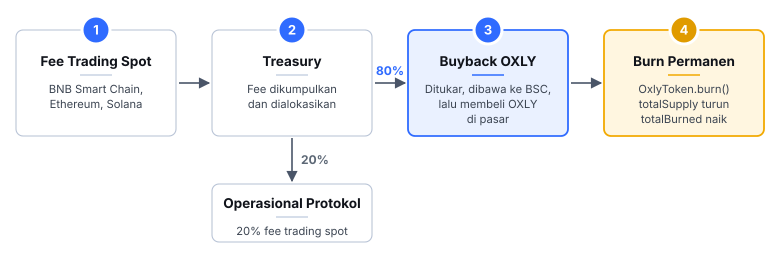

# 11 Pendapatan, Buyback & Burn

## 11.1 Sumber Pendapatan Protokol (Protocol Revenue Streams)

| Sumber Pendapatan | Struktur Tarif | Mekanisme Distribusi & Alokasi |
|---|---|---|
| **Biaya Trading Spot (BSC, Ethereum, Solana)** | Maker 0,1% / Taker 0,1% | **80% untuk buyback & burn** · 20% untuk operasional protokol |
| **Biaya Listing Token** | 50.000 OXLY per pengajuan listing | **50% di-burn secara permanen** · 50% untuk operasional protokol |
| **Biaya Kekurangan Kapasitas OXG** | Dibayarkan dalam OXLY saat kuota OXG tidak mencukupi | **100% di-burn secara permanen** |
| **Oxly Live – Live Developer** | 15.000 OXLY per sesi siaran | 90% didistribusikan kepada penonton valid · 5% pendapatan platform · **5% + alokasi kursi kosong di-burn** |
| **Oxly Live – Fitur Gift** | Ditetapkan per transaksi gift | 95% untuk host · 5% pendapatan platform |
| **Perdagangan Futures** | Sesuai jadwal tarif trading futures | 100% dialokasikan untuk operasional protokol |

## 11.2 Cara Kerja Buyback & Burn

<figure><figcaption><p></p></figcaption></figure>

### Mekanisme Eksekusi dan Transparansi Burn

* **Sentralisasi Jalur Burn (Single-Path Burn Execution):** Smart contract produk tidak mengeksekusi burn secara otomatis di dalam masing-masing transaksi; seluruh penerimaan biaya dalam denominasi OXLY dikumpulkan terlebih dahulu ke dalam treasury protokol, untuk kemudian dialokasikan dan di-burn secara terpusat melalui pemanggilan fungsi `burn()`.
* **Eksekusi Batch Berkala dan Pelaporan Publik:** Proses buyback dan burn dijalankan secara terjadwal dalam batch rutin, di mana setiap eksekusi dipublikasikan secara terbuka pada platform beserta rincian nominal dan hash transaksi on-chain.

## 11.3 Kebijakan Batas Maksimal Burn (Burn Cap Policy)

Untuk menjaga kedalaman likuiditas pasar dan keberlanjutan utilitas ekosistem jangka panjang, platform menerapkan kebijakan pembatasan akumulasi burn token (burn cap) maksimal sebesar **75% dari total supply yang telah di-mint (`totalMinted`)**. Kebijakan ini memastikan bahwa sekurang-kurangnya 25% dari seluruh token OXLY yang pernah diterbitkan akan senantiasa bertahan di dalam peredaran, yang diverifikasi oleh operasional platform setiap kali eksekusi `burn()` dijalankan.

```
Supply Beredar = totalMinted − totalBurned = totalSupply()
```
