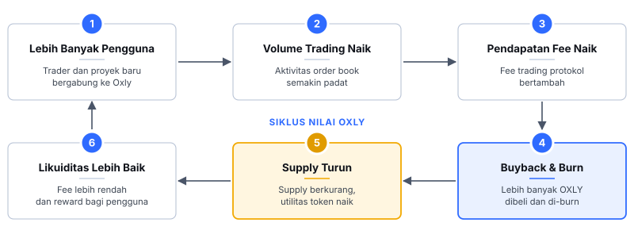
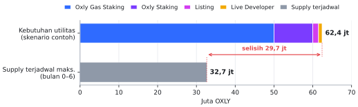
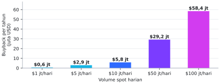
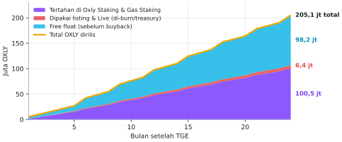
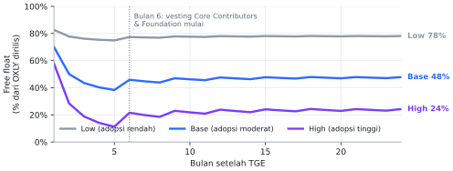
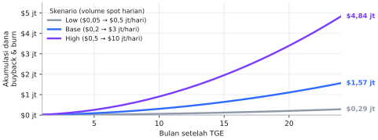

# 12 Akumulasi Nilai & Potensi Pertumbuhan Token


**Hanya ilustrasi.** Bab ini menjelaskan mekanisme yang mengaitkan aktivitas platform dengan permintaan dan supply OXLY memakai model sederhana dan input hipotetis. Angka-angka ini bukan prediksi, target harga, atau janji. Harga OXLY ditentukan pembeli dan penjual, dan bisa turun maupun naik.


## 12.1 Siklus Nilai

<figure><figcaption>

</figcaption></figure>

Token OXLY mengakumulasi nilai melalui dua mekanisme fundamental yang bekerja secara simultan: pertumbuhan **permintaan** organik yang selaras dengan adopsi dan volume transaksi platform, serta pengendalian **supply** yang hanya terbit berdasarkan realisasi distribusi (on-demand mint) dan terus tereduksi secara permanen melalui mekanisme burn.

## 12.2 Katalis dan Penggerak Permintaan (Demand Drivers)

| Katalis Permintaan | Mekanisme Eksekusi | Karakteristik Permintaan |
|---|---|---|
| **Program Buyback** | Sebesar 80% dari biaya trading spot di ketiga jaringan dialokasikan untuk membeli OXLY secara langsung di pasar terbuka. | Berulang (recurring), bertumbuh selaras dengan peningkatan volume trading. |
| **Listing Token** | Setiap pengajuan proyek diwajibkan membayar biaya sebesar 50.000 OXLY. | Berulang (recurring), meningkat seiring bertambahnya proyek baru yang masuk. |
| **Oxly Live (Live Developer)** | Pengembang proyek diwajibkan mengalokasikan 15.000 OXLY per sesi siaran. | Berulang (recurring), selaras dengan frekuensi promosi proyek. |
| **Diskon Biaya Trading** | Staking hingga 10.000.000 OXLY untuk memperoleh potongan biaya spot hingga 100%. | Terkunci (held/staked), meningkat seiring skala aktivitas trader dan market maker. |
| **Trading Tanpa Biaya Gas** | Trader aktif melakukan staking OXLY untuk memperoleh kuota kapasitas OXG. | Terkunci (held/staked), bertumbuh seiring frekuensi penempatan order. |
| **Reward Staking** | Partisipasi staking dengan imbal hasil hingga 24% APY tanpa periode penguncian (no lock-up). | Terkunci (held/staked), mengurangi likuiditas beredar secara sukarela. |
| **Kompensasi Kekurangan Gas** | Kekurangan kuota OXG dibayar menggunakan token OXLY untuk kemudian di-burn secara permanen. | Berulang (recurring), langsung mereduksi supply beredar. |

## 12.3 Dinamika Supply Beredar Terbatas dan Multi-Utilitas

### Asal Mula Distribusi Supply Beredar Awal

Tidak terdapat entitas maupun pihak internal mana pun yang memulai fase peluncuran dengan kepemilikan alokasi besar. Sepanjang enam bulan pertama sejak TGE, hampir seluruh unit token OXLY baru masuk ke dalam peredaran secara eksklusif melalui program airdrop komunitas—dan hanya di-mint pada saat peserta yang memenuhi syarat secara aktif memperoleh serta mengklaim hak alokasi mereka.

| Sumber terjadwal, bulan 0–6 | OXLY maks. | Porsi |
|---|---:|---:|
| Airdrop (sesi 1), diperoleh komunitas | 30.000.000 | 91,8% |
| Operational Cost | 2.670.000 | 8,2% |
| Core Contributors | 0 | 0% |
| Foundation & Operations | 0 | 0% |
| **Total** | **32.670.000** | **100%** |

### Simulasi Kebutuhan Utilitas vs. Supply Terjadwal (Periode 6 Bulan Pertama)

| Kategori Utilitas / Parameter | Asumsi Skenario Adopsi | Kebutuhan / Jumlah Token |
|---|---|---:|
| Oxly Gas Staking | 1.000 trader Tier 1, 200 Tier 2, 40 Tier 3, 10 Tier 4, dan 1 market maker Tier 5 | 50.000.000 OXLY |
| Oxly Staking | Partisipasi staking imbal hasil (yield) komunitas | 10.000.000 OXLY |
| Biaya Listing Token | 5 pengajuan listing per bulan selama 6 bulan (30 × 50.000 OXLY) | 1.500.000 OXLY |
| Oxly Live – Live Developer | 10 sesi siaran per bulan selama 6 bulan (60 × 15.000 OXLY) | 900.000 OXLY |
| **Total Kebutuhan dari Utilitas Platform** | **Akumulasi permintaan utilitas murni pada 6 bulan pertama** | **62.400.000 OXLY** |
| **Supply Terjadwal Maksimal** | Batas emisi maksimal pada periode 6 bulan yang sama | **32.670.000 OXLY** |

<figure><figcaption>
Kebutuhan utilitas platform dibandingkan supply terjadwal maksimal, bulan 0–6 (juta OXLY, skenario contoh)
</figcaption></figure>

Pada skenario adopsi moderat ini, kebutuhan utilitas organik platform sendiri telah melampaui batas maksimal supply yang dapat beredar sepanjang enam bulan pertama sebesar **29.730.000 OXLY**—bahkan sebelum memperhitungkan tekanan beli dari mekanisme buyback protokol maupun akumulasi investor yang menahan (hold) aset. Mengingat seluruh kuota mint dikunci secara permanen di dalam smart contract token, protokol tidak dapat menambah supply untuk merespons lonjakan permintaan tersebut, sehingga mekanisme penyeimbangan bertumpu sepenuhnya pada penyesuaian harga di pasar terbuka (price discovery).

## 12.4 Model Buyback

| | Nama | Rumus |
|---|---|---|
| **BB** | ****Buyback Tahunan (USD)**** *Annual Buyback* | BB = Volume Spot Harian × 365 × 0,2% × 80% = Volume Spot Harian × 0,584 |

*Keterangan: 365 = hari per tahun · 0,2% = fee maker 0,1% + fee taker 0,1% per trade · 80% = porsi fee untuk buyback & burn.*

<figure><figcaption>
Buyback & burn tahunan menurut volume spot harian (juta USD, kotor)
</figcaption></figure>

| Pangsa volume spot DEX 3 chain saat ini | Volume harian | Buyback tahunan |
|---|---:|---:|
| 0,1% | ~$5,3 jt | ~$3,1 jt |
| 0,5% | ~$26,3 jt | ~$15,4 jt |
| 1,0% | ~$52,6 jt | ~$30,7 jt |
| 2,0% | ~$105,2 jt | ~$61,4 jt |

*Volume spot DEX di tiga chain ±$158 miliar pada September 2026 (±$5,3 miliar per hari, Bab 3.3). Diskon fee untuk staker menurunkan buyback secara proporsional.*

## 12.5 Rasio Buyback terhadap Market Cap (Buyback Yield)

| | Nama | Rumus |
|---|---|---|
| **BY** | ****Buyback Yield**** *Buyback to Market Cap Ratio* | Buyback Yield = (Nilai Buyback Tahunan) ÷ (Market Cap Beredar (Circulating Market Cap)) |

Pemodelan analisis pada bagian ini menggunakan asumsi konservatif sebesar 150.000.000 OXLY beredar—angka yang lebih dari dua kali lipat proyeksi supply terjadwal pada akhir Tahun ke-1 (69.000.000 OXLY).

| Harga | Market cap (150 jt) | Yield @ $1 jt/hari | @ $10 jt/hari | @ $50 jt/hari |
|---:|---:|---:|---:|---:|
| $0,01 | $1,5 jt | 38,9% | 389% | 1.947% |
| $0,05 | $7,5 jt | 7,8% | 77,9% | 389% |
| $0,10 | $15,0 jt | 3,9% | 38,9% | 195% |
| $0,25 | $37,5 jt | 1,6% | 15,6% | 77,9% |
| $0,50 | $75,0 jt | 0,8% | 7,8% | 38,9% |

Rasio buyback yield di atas 100% mengindikasikan bahwa dalam rentang waktu satu tahun, alokasi dana buyback protokol harus menyerap jumlah token OXLY yang lebih besar daripada keseluruhan supply beredar pada tingkat harga tersebut—suatu kondisi yang secara matematis tidak dapat tercapai tanpa adanya apresiasi harga pasar. Oleh karena itu, mekanisme buyback menciptakan **tekanan beli (upward price pressure) yang terakumulasi secara progresif seiring meningkatnya volume perdagangan**, hingga tingkat yield mencapai titik keseimbangan (equilibrium) dengan likuiditas jual di pasar.

## 12.6 Titik Impas Emisi (Emission Break-Even Threshold)

| | Nama | Rumus |
|---|---|---|
| **BEP** | ****Volume Harian Titik Impas**** *Break-Even Daily Volume* | Volume Titik Impas = (Emisi Terjadwal Tahunan × Harga OXLY) ÷ 0,584 |

| Harga | Tahun 1 (69,1 jt) | Tahun 2–4 (56,2 jt/tahun) | Per sesi airdrop tambahan (25 jt) |
|---:|---:|---:|---:|
| $0,005 | $0,59 jt/hari | $0,48 jt/hari | + $0,21 jt/hari |
| $0,01 | $1,18 jt/hari | $0,96 jt/hari | + $0,43 jt/hari |
| $0,05 | $5,91 jt/hari | $4,81 jt/hari | + $2,14 jt/hari |
| $0,10 | $11,83 jt/hari | $9,62 jt/hari | + $4,28 jt/hari |

Pada tingkat volume perdagangan di atas titik impas (break-even point), nilai beli yang dihasilkan oleh program buyback protokol melampaui nilai seluruh alokasi emisi terjadwal yang masuk ke dalam peredaran—bahkan dalam skenario ekstrem di mana 100% token yang baru dirilis langsung dijual ke pasar. Memasuki Tahun ke-7, laju emisi terjadwal menyusut hingga berada di bawah 14.000.000 OXLY per tahun, sehingga tingkat volume perdagangan yang sama akan memberikan dampak deflasi bersih dan dukungan valuasi yang jauh lebih signifikan.

## 12.7 Permintaan Inelastis dari Utilitas Produk (Price-Inelastic Product Demand)

| Aktivitas produk (contoh) | OXLY dibeli dari pasar / tahun | OXLY di-burn / tahun |
|---|---:|---:|
| 10 listing per bulan | 6.000.000 | 3.000.000 |
| 25 listing per bulan | 15.000.000 | 7.500.000 |
| 20 siaran Live Developer per bulan | 3.600.000 | ≥ 180.000 |
| 10 market maker di Tier 5 | 100.000.000 di-stake | — |

Aliran permintaan ini beroperasi di luar mekanisme buyback berbasis biaya transaksi dan bersifat independen terhadap fluktuasi harga pasar OXLY. Karena tarif biaya listing token (50.000 OXLY) dan penyelenggaraan Live Developer (15.000 OXLY) didenominasikan secara tetap dalam unit token OXLY, setiap proyek maupun penyelenggara wajib menyerap jumlah unit token yang konstan dari pasar terbuka tanpa memandang valuasi harga token saat transaksi dilakukan.

## 12.8 Pemodelan Simulasi Aliran Token (24-Month Token Flow Simulation)

Oxly memodelkan dinamika aliran bersih token (net token flow) sepanjang 24 bulan pertama ke dalam tiga skenario adopsi, dengan membandingkan seluruh sumber penerbitan supply baru—mencakup program airdrop (dengan asumsi konservatif rilis sesi baru setiap enam bulan), jadwal vesting alokasi terkunci, reward staking, dan program Ecosystem Growth Fund (EGF)—terhadap volume OXLY yang terkunci di dalam kontrak staking serta yang terserap oleh utilitas listing dan Oxly Live. Metodologi pemodelan ini dirancang berdasarkan unit riil token sehingga hasilnya bersifat objektif dan tidak bergantung pada asumsi fluktuasi harga pasar.

| Asumsi di bulan 24 | Low | Base | High |
|---|---:|---:|---:|
| Volume spot harian | $0,5 jt | $3 jt | $10 jt |
| Pengguna Gas Staking (Tier 1/2/3/4/5) | 300/50/10/2/0 | 1.000/200/40/10/1 | 2.000/400/60/15/2 |
| Porsi OXLY beredar di Oxly Staking | 15% | 25% | 30% |
| Listing / Live Developer per bulan | 2 / 3 | 5 / 10 | 15 / 25 |

<figure><figcaption>
Ke mana OXLY yang dirilis mengalir, skenario Base, sebelum buyback & burn (juta OXLY). Ketiga lapisan berjumlah sama dengan total OXLY dirilis.
</figcaption></figure>

<figure><figcaption>
Porsi OXLY dirilis yang bebas diperdagangkan (free float), sebelum buyback & burn. Makin rendah, makin banyak OXLY yang tertahan di staking dan utilitas.
</figcaption></figure>

<figure><figcaption>
Akumulasi dana USD dari 80% fee trading spot yang dialokasikan untuk buyback & burn, setelah diskon fee staker.
</figcaption></figure>

| Skenario | Bulan | OXLY dirilis | Tertahan di staking | Free float | Akumulasi USD buyback |
|---|---:|---:|---:|---:|---:|
| Low | 12 | 85,6 jt | 17,5 jt | 78% | $0,08 jt |
| Low | 24 | 179,7 jt | 36,8 jt | 78% | $0,29 jt |
| Base | 12 | 97,6 jt | 48,0 jt | 48% | $0,43 jt |
| Base | 24 | 205,1 jt | 100,5 jt | 48% | $1,57 jt |
| High | 12 | 111,1 jt | 75,1 jt | 24% | $1,28 jt |
| High | 24 | 232,6 jt | 157,2 jt | 24% | $4,84 jt |

### Implikasi dan Hasil Utama Simulasi

Hasil pemodelan menunjukkan dampak langsung dari penguncian utilitas terhadap likuiditas pasar sekunder: pada skenario Base, sekitar 50% dari total OXLY yang dirilis terserap dan terkunci di dalam kontrak staking, menyisakan hanya sekitar setengahnya yang beredar bebas (free float) di pasar—bahkan sebelum memperhitungkan penyusutan supply akibat mekanisme buyback. Pada skenario High, rasio free float tersebut menyusut lebih jauh hingga tersisa sekitar 24% dari total rilis. Rasio free float yang lebih tipis secara struktural meningkatkan sensitivitas pasar (price elasticity), di mana setiap aliran modal yang masuk maupun keluar akan menghasilkan dampak pergerakan harga yang lebih besar ke kedua arah.
