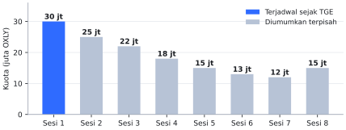
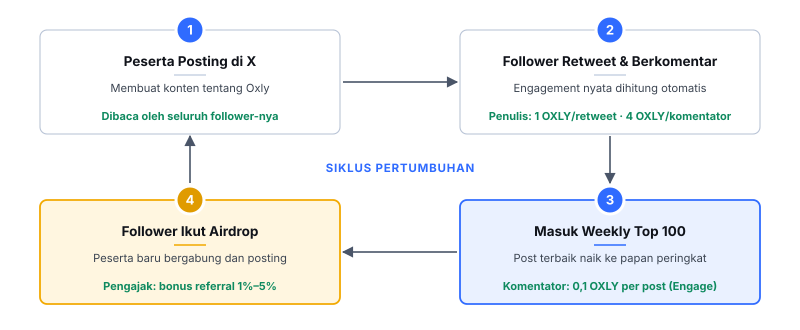
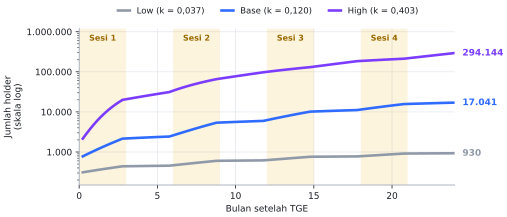
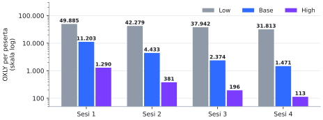

# 13 Program Airdrop (Fairlaunch)

## 13.1 Gambaran Umum

**150.000.000 OXLY** (15% supply) dibagikan ke komunitas dalam **8 sesi**, masing-masing dengan kuota tetap yang dijaga kontrak `OxlyAirdrop`. Kuota menurun untuk menghargai partisipasi awal, dengan sesi terakhir yang lebih besar untuk pengguna setia.

<figure><figcaption>
Kuota airdrop per sesi, total 150 juta OXLY
</figcaption></figure>

| Sesi | Periode (UTC) | Kuota | Porsi |
|---|---|---:|---:|
| 1 | 28 Nov 2026 – 27 Feb 2027 (klaim s.d. 28 Mei 2027) | 30 jt | 20,0% |
| 2 | Diumumkan terpisah | 25 jt | 16,7% |
| 3 | Diumumkan terpisah | 22 jt | 14,7% |
| 4 | Diumumkan terpisah | 18 jt | 12,0% |
| 5 | Diumumkan terpisah | 15 jt | 10,0% |
| 6 | Diumumkan terpisah | 13 jt | 8,7% |
| 7 | Diumumkan terpisah | 12 jt | 8,0% |
| 8 | Diumumkan terpisah | 15 jt | 10,0% |
| **Total** |   | **150 jt** | **100%** |

### Mekanisme Pelaksanaan Sesi (Session Execution Mechanics)

* **Peluncuran Sesi 1:** Sesi 1 dimulai bertepatan dengan TGE, berlangsung selama 3 bulan, dan menggunakan struktur komponen distribusi yang diuraikan pada bab ini.
* **Kemandirian dan Penutupan Sesi:** Setiap sesi merupakan program distribusi yang terpisah dan berdiri sendiri. Apabila periode sesi berakhir atau batas kuota telah terpenuhi, sesi tersebut akan ditutup secara resmi dan distribusi airdrop dihentikan sementara; sisa alokasi reward dari sesi yang telah ditutup tidak dialihkan (carry-over) ke sesi berikutnya.
* **Aktivasi Sesi Lanjutan (Sesi 2–8):** Pelaksanaan Sesi 2 hingga Sesi 8 tidak bersifat otomatis maupun berkesinambungan langsung setelah sesi sebelumnya, melainkan baru dimulai setelah diumumkan secara resmi. Setiap pengumuman akan menetapkan durasi periode, aturan main, serta kriteria tugas yang dapat disesuaikan—misalnya ditujukan bagi pengguna eksisting dengan parameter aktivitas trading spot maupun futures. Tanggal setiap sesi dicatat di kontrak OxlyAirdrop oleh owner protokol sebelum sesi dimulai dan hanya dapat disesuaikan sebelum sesi berakhir; sesi tidak pernah tumpang tindih, dan jeda antarsesi diperbolehkan.
* **Penyelesaian Program:** Keseluruhan rangkaian program airdrop tidak terikat pada tanggal akhir yang kaku, melainkan dinyatakan selesai secara menyeluruh setelah kedelapan sesi telah dijalankan.

## 13.2 Persyaratan Partisipasi (Eligibility Requirements)

Untuk berpartisipasi dalam program distribusi airdrop dan memenuhi syarat klaim reward, pengguna wajib menyelesaikan tahapan verifikasi berikut:

1. ****Otorisasi Akun dan Pengikatan Dompet**.** Melakukan pendaftaran melalui autentikasi X OAuth untuk mengikat satu akun X secara eksklusif ke satu alamat dompet (wallet).
2. ****Verifikasi Tugas Sosial**.** Mengikuti (follow) akun resmi Oxly di platform X, menghubungkan akun Telegram, serta bergabung ke dalam grup komunitas dan kanal pengumuman resmi Oxly di Telegram.
3. ****Validasi Aktivitas On-Chain**.** Mengeksekusi sekurang-kurangnya satu transaksi pada platform Oxly.

## 13.3 Komponen (Sesi 1)

* **1 · Social Campaign** — Posting tentang Oxly di X. Engagement dihitung pada hari ke-10, 20, dan 30 setelah disetujui: **1 OXLY per retweet** dan **4 OXLY per komentator unik**.
* **2 · Engage** — Berkomentar di **100 post teratas minggu ini**: **0,1 OXLY per post** yang masih di top 100 final saat minggu ditutup.
* **3 · Referral bertingkat** — L1 5 referral → 1% · L2 20 → 2% · L3 50 → 3% · L4 100 → 5% dari perolehan referral.
* **4 · Volume Trading** — Volume spot di BNB Smart Chain per sesi: 0–1 rb USDT → 1.000 · 1–10 rb → 4.000 · >10 rb → 12.000 OXLY. Pair OXLY dihitung 2×.

| | Nama | Rumus |
|---|---|---|
| **RC** | ****Reward Social Campaign**** *per hitungan (hari ke-10, 20, 30)* | RC = ΔRetweet × 1 OXLY + ΔKomentator Unik × 4 OXLY |
| **HB** | ****Hak Bonus Referral**** *Σ atas seluruh referral valid* | HB = % Level × Σ (Reward Campaign + Reward Volume) |
| **BR** | ****Bonus Referral Baru**** *New Referral Bonus* | BR = max(0, HB − Bonus yang Sudah Diterima) |

### Kriteria Validasi dan Pengecualian Perhitungan (Anti-Sybil & Wash-Trading Filters)

* **Pengecualian Interaksi Sosial:** Aktivitas like, quote tweet, interaksi yang berasal dari akun penulis sendiri, serta interaksi dari akun dengan usia registrasi ≤ 1 tahun tidak diperhitungkan dalam kalkulasi poin. Selain itu, kontribusi dari satu akun komentator dibatasi maksimal 3 kali dalam periode 24 jam.
* **Pengecualian Volume Trading:** Transaksi dengan diri sendiri (self-trading), transaksi antar-dompet yang teridentifikasi memiliki keterkaitan (related wallets), serta volume perdagangan dengan tarif biaya 0% (zero-fee volume) dikecualikan dari perhitungan volume yang memenuhi syarat.
* **Penyesuaian Parameter Sesi:** Seluruh ketetapan di atas merupakan parameter dasar awal (baseline parameters) yang dapat disesuaikan pada setiap sesi airdrop dan akan diumumkan secara resmi sebelum sesi terkait mulai berlaku.

## 13.4 Mekanisme dan Aturan Klaim (Claim Mechanics)

| Parameter Aturan | Spesifikasi Teknis & Ketentuan |
|---|---|
| Model Akumulasi | **Kumulatif (Cumulative Claim Model):** Sistem Oxly menerbitkan tanda tangan kriptografis berstandar EIP-712 untuk mengotorisasi total hak kumulatif alamat dompet (wallet); pengguna mengeksekusi klaim atas selisih antara total hak kumulatif tersebut dengan jumlah yang telah diklaim sebelumnya (`Klaim = Total Hak − Sudah Diklaim`). |
| Cakupan & Waktu Klaim | Seluruh komponen reward digabungkan dalam satu transaksi klaim terpadu yang dapat dieksekusi kapan saja sejak kredit reward pertama tercatat. |
| Biaya Gas (Gas Fee) | Ditanggung sepenuhnya oleh pengguna dalam denominasi BNB saat mengeksekusi transaksi klaim pada jaringan BNB Smart Chain. |
| Tenggat Waktu Klaim | Berlaku selama **90 hari terhitung setelah periode sesi berakhir**; seluruh alokasi reward yang tidak diklaim hingga tenggat waktu berakhir **tidak akan pernah di-mint**. |
| Penutupan & Batas Kuota | Apabila batas kuota sesi telah terpenuhi, sesi akan ditutup secara otomatis; akumulasi reward yang melampaui kuota sesi tidak dibayarkan dan tidak dialihkan (carry-over) ke sesi berikutnya. |

## 13.5 Protokol Mitigasi Sybil (Anti-Sybil Safeguards)

Untuk menjaga integritas distribusi dan memastikan bahwa reward hanya tersalurkan kepada peserta organik yang valid, Oxly menerapkan filter verifikasi berlapis:

* **Verifikasi Identitas & Usia Akun:** Pengikatan eksklusif satu akun X per alamat dompet melalui autentikasi OAuth, dengan syarat usia registrasi akun X > 1 tahun.
* **Validasi Aktivitas Riil:** Kewajiban mengeksekusi minimal satu transaksi valid pada platform Oxly.
* **Moderasi Interaksi Sosial:** Peninjauan kualitas terhadap komentar yang dipublikasikan serta pembatasan frekuensi maksimal 3 komentar per 24 jam untuk setiap akun.
* **Penyaringan Manipulasi Volume:** Pengecualian otomatis terhadap transaksi self-trading, aktivitas antar-dompet yang teridentifikasi memiliki keterkaitan (related wallets), serta volume perdagangan dengan tarif biaya nol (zero-fee volume).

## 13.6 Mesin Pertumbuhan Berbasis Komunitas (Community-Driven Growth Engine)

Program Fairlaunch dirancang secara strategis sebagai mesin pemasaran dan akuisisi pengguna utama bagi ekosistem Oxly. Alih-alih mengalokasikan anggaran untuk belanja iklan konvensional yang bersifat satu arah, Oxly mendistribusikan nilai secara langsung kepada komunitas dalam bentuk token OXLY sebagai bentuk penghargaan atas jangkauan jaringan dan pertumbuhan organik yang mereka ciptakan sendiri.

<figure><figcaption>

</figcaption></figure>

### Mekanisme Pertumbuhan Komunitas (Community Growth Flywheel)

| Mekanisme Pertumbuhan | Dampak Strategis terhadap Ekosistem |
|---|---|
| **Social Campaign** | Menjadikan setiap peserta sebagai pembuat konten organik. Karena perolehan reward bergantung pada interaksi (engagement) nyata, peserta terdorong untuk membuat post berkualitas tinggi yang menarik untuk dibagikan. |
| **Weekly Top 100** | Papan peringkat (leaderboard) publik yang diperbarui setiap hari Senin untuk memusatkan perhatian dan visibilitas komunitas pada post dengan performa terbaik. |
| **Mekanisme Engage** | Memusatkan percakapan mengenai Oxly pada periode mingguan dan utas post tertentu—pola interaksi terkonsentrasi yang secara alami memicu algoritma trending topic. |
| **Sistem Referral Bertingkat** | Memberikan insentif berkelanjutan jangka panjang bagi peserta untuk mengajak serta mengedukasi pengguna baru ke dalam ekosistem. |
| **Insentif Volume Trading** | Mengonversi pengguna baru yang masuk melalui komunitas menjadi trader aktif yang berkontribusi langsung pada likuiditas pasar serta pendanaan buyback protokol. |

### Pemodelan Matematika Pertumbuhan Viral (Viral Growth Modeling)

Untuk memproyeksikan efektivitas akuisisi pengguna organik dari program Fairlaunch, Oxly menggunakan kerangka pemodelan epidemiologis berbasis koefisien viralitas mingguan (*k*) yang dikalibrasi dengan faktor saturasi audiens serta dinamika insentif ekonomi peserta:

| | Nama | Rumus |
|---|---|---|
| **k** | ****Koefisien Viralitas**** *Viral Coefficient (per minggu)* | *k* = *P*post × *F*post × *N̄*follower × *R*impresi × *B*engage × *R*konversi |
| **ΔU** | ****Peserta Baru**** *New Participants* | Δ*U*baru = *U*aktif × *k* × *M* × (1 − *U*terjangkau ÷ *U*audiens) |
| **M** | ****Indeks Motivasi**** *Motivation Index* | *M* = *R* ÷ (*R* + $25) , *R* = *Q*sesi ÷ *U*aktif × $0,01 |
| **Ut+1** | ****Peserta Aktif Berikutnya**** *Active Participants* | *U*aktif, t+1 = *U*aktif, t × (1 − *r*churn) + Δ*U*baru |
| **N** | ****Jumlah Holder**** *Holders* | *N*holder = *U*kumulatif × *R*retensi |

***Keterangan Variabel:***

* *k*: Koefisien viralitas mingguan (jumlah peserta baru yang dihasilkan per peserta aktif per minggu).
* *P*post, *F*post: Rasio peserta aktif yang memublikasikan konten dan frekuensi post per minggu.
* *N̄*follower, *R*impresi: Rata-rata jumlah follower per akun serta tingkat keterjangkauan impresi organik (impression rate).
* *B*engage, *R*konversi: Faktor pengali dari mekanisme Engage serta tingkat konversi audiens menjadi peserta terverifikasi.
* *M*, *R*: Indeks motivasi partisipasi dan estimasi nilai proyeksi reward per peserta aktif (dengan asumsi valuasi referensi $0,01 per OXLY).
* *U*terjangkau, *U*audiens: Total populasi yang telah terpapar kampanye dibandingkan dengan total ukuran audiens alamat (addressable audience) pada platform X.

### Parameter Asumsi Skenario Pertumbuhan Viral

| Parameter Model | Skenario Low | Skenario Base | Skenario High |
|---|---:|---:|---:|
| Jumlah Peserta Awal (*U*0) | 500 | 1.000 | 2.000 |
| Porsi Peserta Posting · Frekuensi / Minggu | 30% · 1,5 | 40% · 2,0 | 50% · 2,0 |
| Rata-Rata Follower · Tingkat Impresi | 300 · 5% | 500 · 6% | 600 · 8% |
| Pengali Engage (*B*engage) · Tingkat Konversi | ×1,10 · 0,5% | ×1,25 · 0,4% | ×1,40 · 0,6% |
| Tingkat Churn Mingguan · Total Audiens X | 2,0% · 3.000.000 | 2,0% · 5.000.000 | 1,5% · 10.000.000 |
| Rasio Konversi Menjadi Holder OXLY | 60% | 70% | 80% |
| **Koefisien Viralitas (*k*) pada Motivasi Penuh** | **0,037** | **0,120** | **0,403** |

<figure><figcaption>
Jumlah holder kumulatif dari campaign per skenario (skala logaritmik). Area kuning menandai sesi airdrop yang berjalan, dengan asumsi sesi baru setiap enam bulan.
</figcaption></figure>

<figure><figcaption>
Rata-rata OXLY yang diterima per peserta di setiap sesi (skala logaritmik). Makin banyak peserta, kuota sesi yang sama dibagi ke lebih banyak orang.
</figcaption></figure>

| Skenario | Bulan 3 | Bulan 6 | Bulan 12 | Bulan 24 | OXLY per peserta, sesi 1 → 4 |
|---|---:|---:|---:|---:|---:|
| Low | 441 | 465 | 627 | 930 | 49.885 → 31.813 |
| Base | 2.175 | 2.594 | 6.230 | 17.041 | 11.203 → 1.471 |
| High | 20.698 | 33.733 | 99.806 | 294.144 | 1.290 → 113 |

### Analisis Sensitivitas Koefisien Viralitas (*k*) dan Disiplin Supply

Variabel paling menentukan dalam model ini adalah koefisien viralitas (*k*), yang mengukur rata-rata jumlah peserta baru yang berhasil diajak oleh setiap peserta aktif per minggu. Nilai *k* meningkat secara proporsional seiring bertambahnya rasio peserta yang aktif membuat post, frekuensi publikasi, serta kualitas daya tarik konten—faktor yang secara langsung diapresiasi oleh skema insentif kampanye.

* **Perbandingan Skenario Pertumbuhan:** Pada skenario Low, nilai *k* berada pada level yang hampir berimbang dengan tingkat penyusutan peserta (churn). Pada skenario Base, populasi 1.000 peserta awal berkembang menjadi sekitar 17.000 holder dalam kurun waktu dua tahun. Sementara pada skenario High, skala adopsi terakselerasi hingga mencapai ratusan ribu holder.
* **Kemandirian Pertumbuhan terhadap Emisi Token:** Ekspansi jumlah peserta tidak pernah menambah batas supply token. Karena kuota reward pada setiap sesi dikunci secara mutlak oleh smart contract, peningkatan jumlah peserta hanya akan mendistribusikan kuota yang sama secara lebih merata ke basis penerima yang lebih luas. Dengan demikian, mekanisme pertumbuhan viral secara eksklusif memperbesar jumlah holder tanpa pernah meningkatkan jumlah token yang diterbitkan.

## 13.7 Arsitektur Distribusi untuk Mitigasi Tekanan Jual

| Fitur Desain Distribusi | Mekanisme Mitigasi Penjualan Terkonsentrasi |
|---|---|
| **Berbasis Kontribusi (Earned, Not Given)** | Setiap unit OXLY diperoleh melalui partisipasi dan kontribusi nyata, sehingga peserta lebih menghargai kepemilikan asetnya dan cenderung tidak melepas token secara impulsif di sembarang harga. |
| **Pelepasan Bertahap (Phased Release)** | Reward terakumulasi dalam porsi bertahap (siklus hari ke-10/20/30, Engage mingguan, serta perhitungan volume per sesi) sehingga mencegah masuknya supply besar secara mendadak. |
| **Fleksibilitas Waktu Klaim** | Peserta dapat mengeksekusi klaim kapan saja dalam tenggat waktu 90 hari, sehingga aktivitas klaim maupun realisasi keuntungan tersebar secara alami di sepanjang waktu. |
| **Distribusi Terdesentralisasi** | Alokasi token tersebar merata kepada basis holder ritel yang luas, alih-alih terkonsentrasi pada segelintir alamat dompet besar (whale). |
| **Insentif Retensi & Utilitas (Holding Incentives)** | Pemegang token memiliki alasan kuat untuk mempertahankan asetnya guna mengakses imbal hasil staking hingga 24% APY, diskon biaya trading, kuota gas OXG, serta fitur Oxly Live. |
| **Jadwal Kuota Menurun (Halving-Style Reduction)** | Kuota distribusi berkurang secara progresif dari 30.000.000 OXLY menjadi 12.000.000 OXLY sepanjang tujuh sesi pertama. |
| **Dukungan Buyback Berkelanjutan** | Sebesar 80% dari pendapatan biaya trading spot secara konsisten dialokasikan untuk melakukan pembelian kembali (buyback) OXLY di pasar terbuka. |
