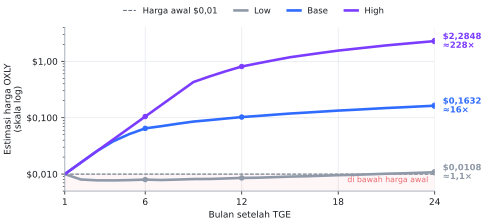
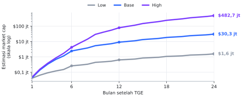

# G Lampiran: Estimasi Model Harga OXLY


**Estimasi, bukan jaminan.** Lampiran ini memperkirakan bagaimana adopsi, volume trading, staking, dan arus pembeli baru dapat memengaruhi harga OXLY, mulai dari harga awal $0,01. Semua angka adalah **estimasi** yang sepenuhnya bergantung pada asumsi di bawah. Harga sebenarnya ditentukan pasar dan bisa jauh lebih rendah maupun lebih tinggi, termasuk turun di bawah harga awal. Estimasi ini bukan prediksi, target, janji imbal hasil, atau ajakan membeli. Baca Bab 17 (Risiko & Disclaimer).


## G-1. Rumus Estimasi

| | Nama | Rumus |
|---|---|---|
| **P** | ****Harga Bulan Berikutnya**** *ε = 0,5 · perubahan −40%…+60%/bulan* | Pt+1 = Pt × [1 + ε × (Permintaan − Penjualan) ÷ (Free Float)] |
| **D** | ****Permintaan (OXLY)**** *Demand* | Buyback + Pembeli Baru + Listing + Live Developer + Stake Baru |
| **S** | ****Penjualan (OXLY)**** *Supply ke pasar* | Airdrop × % Dijual + Operational + Gas Subsidy + 30% Contributors + 50% Foundation + 30% Reward Staking + 50% Live Komunitas |

*Harga awal $0,01. Seluruh komponen permintaan dan penjualan dihitung dalam satuan OXLY per bulan.*

## G-2. Pembeli Baru dan Market Cap

Pembeli yang membelanjakan **I dolar** membeli I ÷ P OXLY. Dari rumus di atas:

| | Nama | Rumus |
|---|---|---|
| **ΔP** | ****Kenaikan Harga**** *Price Impact* | ΔP ÷ P = ε × I ÷ (P × Free Float) |
| **ΔMC** | ****Kenaikan Market Cap**** *Market Cap Impact* | ΔMcap = ε × I × Beredar ÷ (Free Float) |

| Kondisi | Beredar ÷ FreeFloat | Estimasi market cap bertambah per $1 pembelian |
|---|---:|---:|
| 80% beredar bebas | 1,25 | $0,63 |
| 50% beredar bebas | 2,0 | $1,00 |
| 25% beredar bebas | 4,0 | $2,00 |
| 10% beredar bebas | 10,0 | $5,00 |

Makin banyak OXLY tertahan di staking, Gas Staking, listing, dan Live, makin kecil free float dan makin besar dampak setiap dolar pembelian. Arah sebaliknya juga berlaku: setiap dolar penjualan menurunkan market cap dengan pengali yang sama.

## G-3. Asumsi Skenario (Nilai di Bulan 24)

| Asumsi | Low | Base | High |
|---|---:|---:|---:|
| Volume spot harian | $50 rb → $500 rb | $200 rb → $3 jt | $500 rb → $10 jt |
| Pembeli baru per bulan · rata-rata beli | 50 → 500 · $100 | 200 → 3.000 · $200 | 500 → 10.000 · $300 |
| Gas Staking (Tier 1/2/3/4/5) | 300/50/10/2/0 | 1.000/200/40/10/1 | 2.000/400/60/15/2 |
| Porsi beredar di Oxly Staking | 15% | 25% | 30% |
| Listing · Live Developer per bulan | 2 · 3 | 5 · 10 | 15 · 25 |
| Airdrop diklaim · langsung dijual | 70% · 60% | 80% · 45% | 90% · 30% |
| Rata-rata diskon fee | 10% | 15% | 20% |

## G-4. Hasil Estimasi

<figure><figcaption>
Estimasi harga OXLY per skenario, dimulai dari harga awal $0,01 (skala logaritmik).
</figcaption></figure>

<figure><figcaption>
Estimasi market cap beredar per skenario (skala logaritmik).
</figcaption></figure>

| Skenario | Bulan | Estimasi harga | Beredar | Free float | Volume harian | Estimasi market cap | Mcap per $1 |
|---|---:|---:|---:|---:|---:|---:|---:|
| Low | 6 | $0,0080 | 32,8 jt | 25,3 jt | $0,15 jt | $0,3 jt | $0,65 |
| Low | 12 | $0,0085 | 74,9 jt | 58,0 jt | $0,27 jt | $0,6 jt | $0,65 |
| Low | 24 | $0,0108 | 146,7 jt | 113,1 jt | $0,50 jt | $1,6 jt | $0,65 |
| Base | 6 | $0,0647 | 37,4 jt | 16,2 jt | $0,81 jt | $2,4 jt | $1,15 |
| Base | 12 | $0,1027 | 88,4 jt | 40,5 jt | $1,54 jt | $9,1 jt | $1,09 |
| Base | 24 | $0,1632 | 185,4 jt | 85,4 jt | $3,00 jt | $30,3 jt | $1,08 |
| High | 6 | $0,1049 | 40,1 jt | 5,3 jt | $2,57 jt | $4,2 jt | $3,80 |
| High | 12 | $0,8084 | 97,3 jt | 19,9 jt | $5,04 jt | $78,7 jt | $2,44 |
| High | 24 | $2,2848 | 211,3 jt | 47,8 jt | $10,00 jt | $482,7 jt | $2,21 |

* **Low:** harga sempat turun ke ±$0,0077 karena penjualan airdrop lebih besar dari permintaan, lalu pulih perlahan. Volume dan adopsi adalah syarat utama.
* **Base:** ±16× dari harga awal dalam 24 bulan, market cap ±$30 jt dengan volume $3 jt per hari.
* **High:** naik tajam karena staking menahan sebagian besar supply (free float 20–25%).

## G-5. Keterbatasan Estimasi

1. Elastisitas ε adalah asumsi: ε = 0,25 kira-kira separuh kenaikan, ε = 1,0 kira-kira dua kali lipat.
2. Porsi airdrop yang langsung dijual sangat menentukan arah harga di 6 bulan pertama.
3. Kondisi pasar kripto umum (bear market) tidak dimodelkan.
4. Skenario High bergantung pada market maker Tier 5 dan ribuan staker.
5. Sesi airdrop 2–4 diasumsikan setiap 6 bulan; jika lebih lambat, supply lebih kecil.
